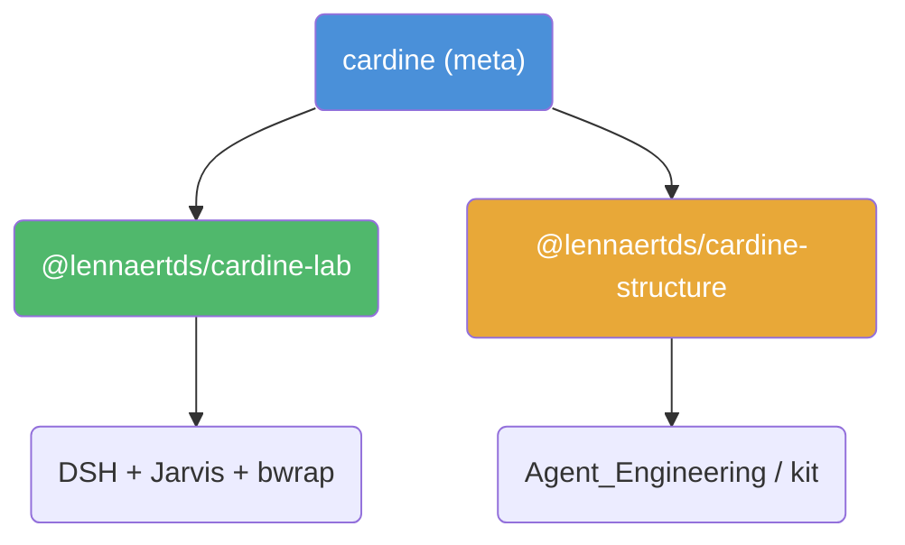

# Cardine

> **Het scharnier voor mens en AI-agent in elk project.**

AI-assistenten werken het best met een vaste projectstructuur. Zonder worden ze
richtingloos: ze raden mappen, missen conventies, en elke nieuwe sessie begint
opnieuw. Mét een vaste boom — docs, data, besluiten, logs — weet een agent
meteen waar hij iets vindt en waar hij het neerzet.

Cardine geeft die structuur, plus de toolchain om er meteen in te werken.
Geen nieuwe editor, geen verplicht abonnement — alleen de standaard en de
gereedschappen, met de agent die je al hebt.

---

## Waarom Cardine?

*Cardine* is de Latijnse ablatief van *cardo* — de spil, het scharnier waar een
stad of constructie omheen draait. *"Waarmee en vanuit waar alles scharniert."*

Het idee is eenvoudig: als elke sessie dezelfde boom aantreft, hoeft een agent
niet telkens te raden waar docs, data of besluiten staan. De projectstandaard
is het scharnier waar mens én agent omheen werken.

Zie voor de achtergrond:
- [docs/decisions/packages-context.md](docs/decisions/packages-context.md) —
  Volledige context: waarom packages, waarom deze keuzes, met links naar ADRs

---

## Packages

Cardine bestaat uit twee packages. De meta-package (`cardine` in de root) is het
uithangbord: README, docs, gidsen. De packages eronder zijn elk apart te
installeren.



| Package | Wat | Voor wie | Installatie |
|---------|-----|----------|-------------|
| **[@lennaertds/cardine-lab]** ⚙️ | Reproduceerbaar AI-agent-werkstation voor Arch Linux / Hyprland. Installeert DSH, Jarvis, bwrap-sandbox en Zed-config in één idempotent script. | Wie Zed + DeepSeek Harness op Arch wil | `curl … \| bash` of `npm install -g @lennaertds/cardine-lab` |
| **[@lennaertds/cardine-structure]** 📁 | Projectstandaard voor ieder project, ongeacht editor of abonnement. Bevat de bewezen `kern/`-`solo/`-`logging/`-boom, modules en stacks, gepulled uit Agent_Engineering. | Iedereen met een project | `npx @lennaertds/cardine-structure` of GitHub release |

### Hoe de packages samenhangen

```
cardine                    ← Meta: repo-root met README, docs, gidsen
├── cardine-lab            ← Toolchain: scripts, sandbox, status-checks
│   └── genereert          → ~/.dsh/profiles/ (ACP-profiel voor DSH)
│   └── bevat              → scripts/, systemd/ (optionele tooling)
└── cardine-structure      ← Projectstandaard: pulled uit Agent_Engineering/kit/
    └── kit/               → Letterlijke kopie op pinned commit
```

De structuur (`cardine-structure`) wordt **niet** in deze repo onderhouden — die
leeft in de privé-sibling [Agent_Engineering](https://github.com/Lennaertds/Agent_Engineering)
en wordt op pinned commits gepulled ([ADR 0013](docs/decisions/0013-cardine-is-het-publieke-uithangbord-en-pullt-de-structure-uit-agent-engineering.md)).
Zo blijft de SSOT op één plek en kan Cardine altijd een stabiele versie
aanbieden.

---

## Installatie-paden

### 📁 Alleen de projectstructuur (elke editor, elk OS)

```bash
npx cardine-structure mijn-project --profile app --modules research,agent
```

Dit zet de volledige projectboom neer met `kern/`, `solo/`, `logging/`, plus
de gekozen modules en stacks. Geen toolchain, geen sandbox — alleen de
structuur. Werkt in VS Code, Zed, Cursor, of een terminal.

Zie de [cardine-structure docs](packages/structure/docs/cardine-structure.md)
voor alle opties (profiles, modules, stacks).

### ⚙️ Volledig AI-agent-werkstation (Arch Linux / Hyprland)

```bash
# 1. Installeer de toolchain (DSH, Jarvis, bwrap, Zed-config)
bash <(curl -fsSL https://raw.githubusercontent.com/Lennaertds/cardine/main/packages/lab/install-lab.sh)

# 2. Voeg de projectstandaard toe
npx cardine-structure mijn-project --profile full
```

Het lab-pad gebruikt Zed als IDE, DeepSeek Harness als agent-loop,
en `deepseek-flash` als model met Claude als tweede provider.
Zie [docs/decisions/packages-context.md](docs/decisions/packages-context.md)
voor de onderbouwing bij elke keuze.

Zie de [cardine-lab docs](packages/lab/docs/cardine-lab.md) voor wat er precies
geïnstalleerd wordt en hoe je sandbox, indexing en status-checks configureert.

---

## Hoe het werkt — in vogelvlucht

1. **Project beginnen**: `cardine-structure` zet een bewezen boom neer.
2. **Structuur leren**: docs/, data/, decisions/ en work/ hebben vaste plekken.
   Een agent navigeert met [docs/INDEX.md](docs/INDEX.md).
3. **Werken met een agent**: Open je editor, start de agent — de structuur
   vertelt hem waar docs, regels en werkitems staan.
4. **Controleren**: `make check` controleert links, lint en tests.
5. **Vastleggen**: `make finish` logt wat je gedaan hebt.
6. **Bijwerken**: Een nieuwe versie van de structuur? `pull_kit.sh` haalt de
   nieuwste pinned commit uit Agent_Engineering.

Zie voor de volledige product-visie en achtergrond:
- [PRODUCT.md](docs/product/PRODUCT.md) — Wat het product doet, per onderdeel
- [totaalproduct.md](docs/product/totaalproduct.md) — Hoe de 9 onderdelen samenhangen
- [ARCHITECTURE.md](docs/architecture/ARCHITECTURE.md) — Containers, stack, dataflow
- [docs/decisions/packages-context.md](docs/decisions/packages-context.md) — Waarom deze
  keuzes: onderzoeksvragen, bronnen, ADRs

---

## Docs en navigatie

| Waar | Wat |
|------|-----|
| [docs/INDEX.md](docs/INDEX.md) | Volledige docs-kaart — start hier voor elke vraag |
| [docs/product/PRODUCT.md](docs/product/PRODUCT.md) | Productoverzicht: wat het doet, voor wie, fasen |
| [docs/decisions/](docs/decisions/) | Architectuurbesluiten (ADR's) — waarom het zo is |
| [docs/packages/VERSIONING.md](docs/packages/VERSIONING.md) | Versiebeheer: SemVer, changelogs, git-tags |
| [AGENTS.md](AGENTS.md) | Instructies voor agenten die aan deze repo werken |

---

## Versiebeheer

Elk package heeft een **eigen versie**, onafhankelijk van de andere.

| Package | Versie | CHANGELOG | Git-tag |
|---------|--------|-----------|---------|
| `cardine` (meta) | 0.3.0 | [CHANGELOG.md](CHANGELOG.md) | `v0.3.0` |
| `@lennaertds/cardine-lab` | 0.3.0 | [packages/lab/CHANGELOG.md](packages/lab/CHANGELOG.md) | `lab-v0.3.0` |
| `@lennaertds/cardine-structure` | 0.4.0 | [packages/structure/CHANGELOG.md](packages/structure/CHANGELOG.md) | `structure-v0.4.0` |

SemVer: `major.minor.patch`. Een *major* is een breaking change (installer werkt
niet meer, kit-structuur wijzigt incompatibel). Een *minor* is nieuwe
functionaliteit. Een *patch* is een bugfix of documentatie.

Het meta-package krijgt een nieuwe versie alleen als de structuur van de meta
(docs, gidsen) wijzigt — niet bij elke package-update. Zie
[docs/packages/VERSIONING.md](docs/packages/VERSIONING.md) voor het volledige
schema.

---

## Ontwikkeling

Deze repo is het **publieke uithangbord**. De projectstandaard en
kennissamenvattingen leven in de sibling-repo
[Agent_Engineering](https://github.com/Lennaertds/Agent_Engineering) (privé, SSOT).
Cardine pullt daaruit — zie `packages/structure/pull_kit.sh`.

Zie [AGENTS.md](AGENTS.md) voor agent-instructies en
[docs/INDEX.md](docs/INDEX.md) voor de volledige documentatie-kaart.

[@lennaertds/cardine-lab]: packages/lab/README.md
[@lennaertds/cardine-structure]: packages/structure/README.md