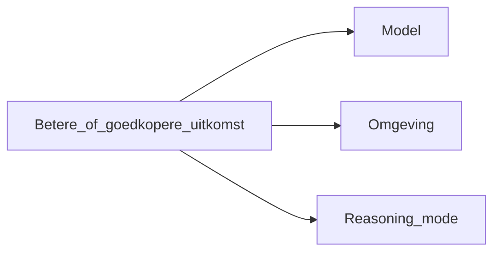

# Drie hefbomen voor AI-efficiëntie

> **Rol:** Thesis-ruggengraat: waar je kosten/kwaliteit kunt verbeteren zonder alles op “meer parameters” te zetten.
> **Niet hier:** operationele projectregels (standaard/kit), of de volledige Hybrid-architectuur ([hybrid-agents](../redeneneren/hybrid-agents.md)).

**Ankers:** P25 (harness tax), P26 (modelkeuze), §29 (serving), §30 (harness-kosten), §35 (hybrid/latent). Overzicht: [kenniskaart](../kenniskaart.md).

---

## 1. Waarom drie assen?

Grote labs verhogen prijzen en raken **diminishing returns** op pure parameterschaal (*scaling wall*). Wie systemen bouwt (bedrijven, bachelorproeven, solo-agents) heeft dan nog steeds drie knoppen:



| Hefboom | Wat je verandert | Typische winst | Risico |
|---------|------------------|----------------|--------|
| **Model** | Welk gewicht, quantisatie, serving-engine, frontier vs smal | Throughput, $/token, latency | Vendor lock-in; claims zonder meting |
| **Omgeving** | Context, docs, harness, checks, slices, tool-keuze | Minder tokens *per taak*, hogere slaagkans | Over-documenteren (harness tax) |
| **Reasoning-mode** | Hoe hard het model “mag nadenken”: CoT-lengte, fase-splitsing, (toekomst) latent/hybrid | Minder zichtbare denk-tokens; snellere paden | Minder audit als je alles verbergt |

Agent Engineering in deze repo is **bewust hefboom Omgeving**. Model en reasoning-mode horen in spoor 2 (fundament) tot je ze zelf served of meet.

---

## 2. Hefboom Model

- **Keuze:** frontier voor open redeneren/code; smalle/goedkope lagen voor routering, filtering, scoring (P26, §31).
- **Serving:** KV-cache, continuous batching, prefix sharing (§29) — winst zonder het gewicht te hertrainen.
- **Quantisatie / open weights:** lagere hardwarekost; kwaliteit en licentie expliciet afwegen ([../open-modellen](../open-modellen/INDEX.md)).
- **Hybrid weights** (§35): alleen relevant als *jij* model + HybridLink-inference draait — niet als Cursor-drop-in.

**Bachelor-link:** model constant houden terwijl je omgeving ablateert (`meten/`) isoleert de bijdrage van docs/checks.

---

## 3. Hefboom Omgeving (Agent Engineering)

Dit is spoor 1:

- Dunne always-on router (`AGENTS.md`); rest JIT (P2).
- Geen afleidbare mappenbomen in context (P5); wel niet-afleidbare valkuilen (P6).
- Uitvoerbare `make check` / hooks i.p.v. prose-only regels (P14).
- Harness tax meetellen: elke always-on regel en elke roundtrip kost (P25, §30).
- Geneste app-regels of smalle `.mdc` — geen duplicaat van AGENTS (P15); zie [cursor-rule](../../../sjablonen/cursor-rule.md).

**Meten:** condities C0–C6 in `meten/` — welke onderdelen van de omgeving de slaagkans en tokens bewegen.

---

## 4. Hefboom Reasoning-mode

Zelfs bij vast model + vaste docs verandert gedrag als je het **denkprotocol** wijzigt:

| Techniek | Laag | Effect (richting) |
|----------|------|-------------------|
| Lange visible CoT | Text | Meer tokens; soms betere kwaliteit |
| Korte stappen / hide future goals (§3) | Prompt/skill | Minder premature “afronden” |
| Sub-agents / smalle vensters (P24, §28) | Harness | Minder context-rot per knoop |
| Latent blocks / HybridAgents (§35) | Model+engine | Minder text-tokens voor intern denken; text voor tools |

Hybrid is hier de **extreme** van reasoning-mode (modelintern). In Cursor-achtige tools blijf je op text-protocollen; de les is hetzelfde: scheid goedkoop denken van duur handelen.

---

## 5. Hoe de hefbomen elkaar raken

| Interactie | Voorbeeld |
|------------|-----------|
| Model × omgeving | Zelfde AGENTS.md is duurder op een logge harness (§30) dan in chat |
| Omgeving × reasoning | Fase-gesplitste skills verlagen CoT-lengte zonder nieuw model |
| Model × reasoning | HybridLink bestaat alleen met het juiste checkpoint + engine |
| Scaling wall → focus | Als M duurder wordt, stijgt de ROI van O en R |

Gebruik de [kenniskaart](../kenniskaart.md) om te zien welke rand je wilt “upgraden” voordat je code of docs herschrijft.

---

## 6. Beslisregel (praktisch)

```
Kan ik het met een check/hook oplossen?     → Omgeving (P14)
Is de always-on context te zwaar?           → Omgeving snoeien (P25)
Is dit het verkeerde model voor de taak?    → Model (P26)
Denk ik te veel in zichtbare tokens?      → Reasoning-mode (skills / later hybrid)
Wil ik HybridAgent in de kit?               → Nee (zie hybrid-agents brug)
```

---

## Wat kan naar de standaard

1. **Geen nieuwe P** enkel voor “drie hefbomen” — P25/P26 + deze pagina volstaan als narratief.
2. **Wel:** bachelor/theorie mag naar deze pagina verwijzen; empirie blijft `meten/bachelorproef.md` (omgeving ableren).
3. **Later:** als metingen tonen dat fase-splitsing (reasoning-mode in prompts) structureel wint, pas dan skill-sjablonen of een P28 overwegen.

## Geen actie (kit)

Geen kit- of bootstrap-wijziging vanuit dit leerstuk alleen.
