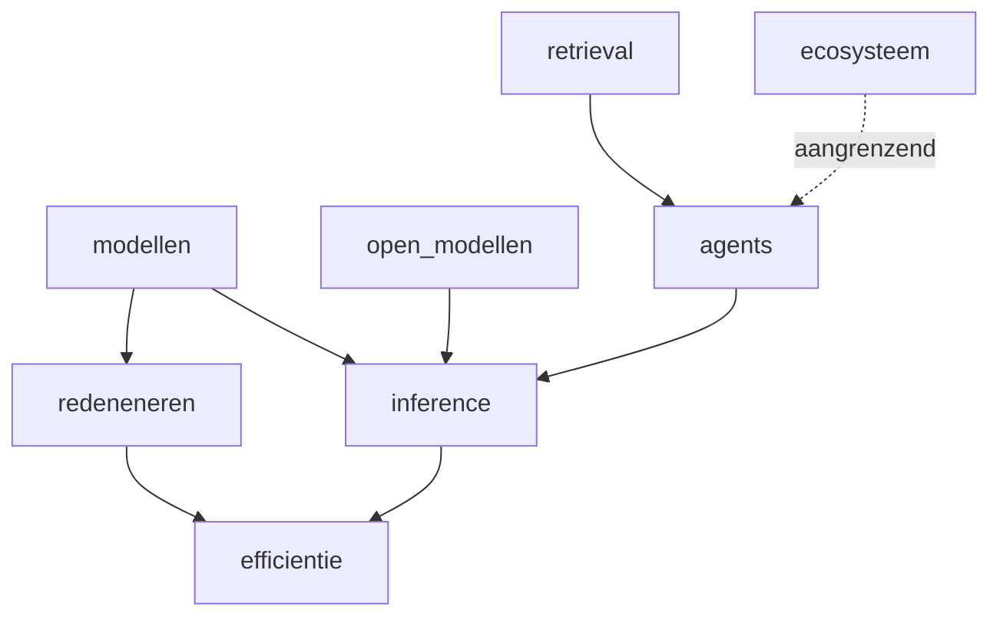
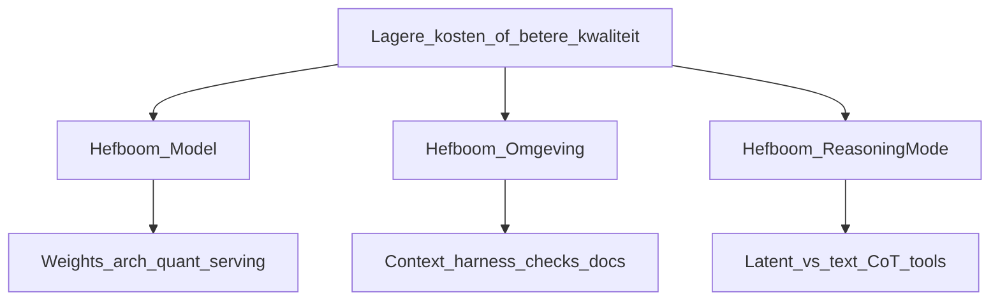
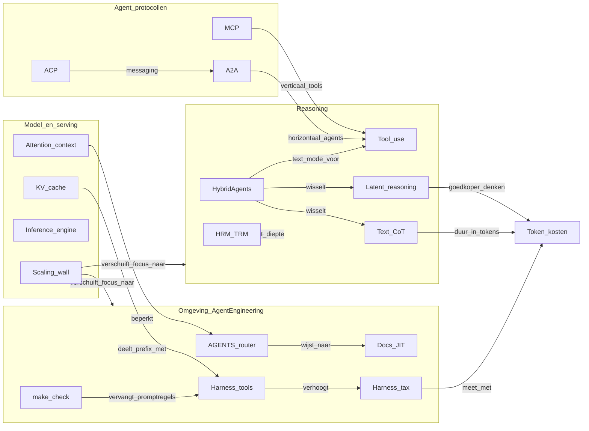

# Kenniskaart — verbanden in AI / Agent Engineering

> **Rol:** Mind map van technische concepten: welke knopen bestaan, hoe ze samenhangen (boom + randen), en waar je dieper leest (§, P, fundament).
> **Niet hier:** volledige uitleg (dat staat in de gelinkte pagina's) of operationele regels (standaard/kit).

Doel: zien **welke verbanden je kunt upgraden** — model, omgeving (Agent Engineering), of reasoning-mode — zonder alles in één essay te stoppen. Themastructuur: [INDEX.md](INDEX.md).

## Hybride mind map (tooling)

| Laag | Bestand | Rol |
|------|---------|-----|
| **Boom (waarheid)** | [kenniskaart-outline.md](kenniskaart-outline.md) | Hiërarchie van knopen; input voor Markmap |
| **Diepte + randen** | dit bestand | Tabellen met §/P/links; cross-links die geen boom zijn |
| **Poster (export)** | `exports/` via `make mindmap` | HTML (en optioneel SVG); geen tweede feitenbron |

```bash
make mindmap          # → bron/fundament/exports/kenniskaart.html
# optioneel poster: open de HTML, of exporteer SVG/PNG vanuit Markmap/browser
```

Preview in de editor: Markmap-extensie op `kenniskaart-outline.md`. De boom bewerken = outline aanpassen; daarna opnieuw exporteren als je een snapshot wilt.

## Acht thema’s (navigatie)



| Thema | INDEX |
|-------|--------|
| Architecturen | [modellen](modellen/INDEX.md) |
| Denken / CoT / hybrid / HRM·TRM | [redeneneren](redeneneren/INDEX.md) |
| Embeddings / RAG | [retrieval](retrieval/INDEX.md) |
| Engines / cache / lokaal HW | [inference](inference/INDEX.md) |
| Hefbomen / optimalisatie | [efficientie](efficientie/INDEX.md) |
| Licenties / Heretic | [open-modellen](open-modellen/INDEX.md) |
| Protocols / skills / n8n | [agents](agents/INDEX.md) |
| Fooocus / AppFlowy | [ecosysteem](ecosysteem/INDEX.md) |

## Drie hefbomen (oriëntatie)

Zie [efficientie/drie-hefbomen.md](efficientie/drie-hefbomen.md). Kort:



## Conceptgraaf (cross-links)

Boom = [outline](kenniskaart-outline.md). Onderstaande randen zijn **geen** boomtakken (meerdere ouders / trade-offs):



## Knopen

| Knoop | Hefboom | Diepte / bron | Principes |
|-------|---------|---------------|-----------|
| Context window / attention budget | Omgeving | §8, §10, §17, §18 | P1–P4 |
| AGENTS.md als dunne router | Omgeving | §14, §34; standaard | P2, P3 |
| Just-in-time docs / kaart | Omgeving | §9, §10, §16 | P2, P5 |
| Harness tax / roundtrips | Omgeving | §25, §30, §33 | P25 |
| Uitvoerbare checks i.p.v. prose | Omgeving | §20; `meten/` | P14 |
| Path-scoped `.mdc` | Omgeving | §13; [cursor-rule](../../sjablonen/cursor-rule.md) | P15, P25 |
| LLM-doorloop (token→head→KV) | Model | [modellen/llm-doorloop](modellen/llm-doorloop.md); §36 | — |
| Transformer / MoE / NCM / LCM | Model | [modellen](modellen/INDEX.md) | — |
| Superposition / width-scaling | Model | [modellen/superposition](modellen/superposition.md); §40 | — |
| NCM coarse-to-fine | Model | [modellen/alternatieven](modellen/alternatieven.md); §38 | — |
| Spec→Verifier→Environment | Omgeving | §37, §41 | P13, P14, P18 |
| World models / VLA | Model | §42; [alternatieven](modellen/alternatieven.md) | — |
| Limits of LLMs (AR/hallucination) | Model | §43 | P13 |
| Generative UI / OpenUI-lang | Omgeving/UI | §44 | P25 |
| BitNet / ternary weights | Model/serving | §45 | P26 |
| Byte-level / End-Of-Token distillatie | Model | [modellen/byte-models](modellen/byte-models.md); §53 | — |
| MoE expert streaming (Colibrì) | Model/serving | §49; [lokaal-hardware](inference/lokaal-hardware.md) | P26 |
| KV-cache / prefix sharing | Model/serving | §29; [inference/caching](inference/caching.md) | — |
| Inference engines / DeepInfer | Model/serving | §29; [inference/engines](inference/engines.md) | P26 |
| Lokaal 64 GB / ~20 GB VRAM | Model/serving | [inference/lokaal-hardware](inference/lokaal-hardware.md) | P26 |
| Embeddings / RAG | Retrieval | [retrieval](retrieval/INDEX.md) | — |
| Text CoT / test-time | Reasoning | [redeneneren/cot-en-test-time](redeneneren/cot-en-test-time.md) | — |
| Latent / HybridAgents | Reasoning | [hybrid-agents](redeneneren/hybrid-agents.md); §35 | — |
| HRM / TRM (tiny recursive) | Reasoning | [hrm-trm](redeneneren/hrm-trm.md); §46 | — |
| MCP / A2A / ACP / ANP | Agents | [agents/protocollen](agents/protocollen.md) | — |
| SkillSpector | Agents | [agents/skills-veiligheid](agents/skills-veiligheid.md) | P14 |
| YAGNI-ladder (Ponytail-les) | Omgeving | §50, §51 | P5 |
| Verbatim agent-memory (MemPalace-les) | Omgeving/Retrieval | §52; [tool-use-en-memory](agents/tool-use-en-memory.md) | P2 |
| Security-scan (Strix-kandidaat) | Omgeving | §47 | P14, P17 |
| Observability (MELT + SLO + cardinality) | Omgeving | §48 | P13 |
| Kit-dekking / horizon | Omgeving | [ecosysteem/kit-dekking-en-horizon](ecosysteem/kit-dekking-en-horizon.md) | — |
| Performance budgets / bench | Omgeving | kit `performance.md`; horizon C1 | P13 |
| n8n / orchestratie | Agents | [agents/orchestratie](agents/orchestratie.md) | P27 |
| Open weights / licenties | Model | [open-modellen/licenties](open-modellen/licenties.md) | — |
| Heretic | Model | [open-modellen/heretic](open-modellen/heretic.md) | — |
| Scaling wall | Model | [drie-hefbomen](efficientie/drie-hefbomen.md) | P26 |
| Fooocus / AppFlowy | Ecosysteem | [ecosysteem](ecosysteem/INDEX.md) | — |

## Randen om te “upgraden”

| Van → naar | Soort | Wat je kunt verbeteren |
|------------|-------|------------------------|
| Scaling wall → Omgeving | verschuift focus | Meer winst uit context/harness/checks wanneer model-schaling duurder wordt |
| Text CoT → Latent / hybrid | trade-off | Minder tokens voor “denken”; text behouden voor tools en audit |
| Text CoT / LLM-schaal → HRM/TRM | trade-off | Diepte via recursie/hiërarchie i.p.v. parameter-count; puzzle-benches ≠ algemene agent-taken |
| Harness → Checks | vervangt | Deterministische guardrails i.p.v. herhaalde promptregels |
| Always-on rules → JIT | snoeit | Schrappen uit AGENTS/`.mdc` wat niet bij elke taak hoort |
| Eén model → Modelkeuze | splitst | Frontier voor open werk; smal/goedkoop voor routering (P26) |
| HybridLink → AGENTS-router | analogie | Dunne always-on laag; zware state JIT — **geen** nieuwe DSL in de kit |
| MCP → A2A/ACP | schaalt | Tools eerst; multi-agent pas als één agent niet genoeg is |
| Prompt-cache ↔ korte AGENTS | versterkt | Stabiele prefix = hogere cache-hit ([caching](inference/caching.md)) |
| Token plateau → Byte overtraining | trade-off | Bij genoeg compute kan byte-distillatie hoger plafond geven (§53); vandaag latency/ecosysteem remmen adoptie |
| Chat-dump → curated docs / ADR | vervangt | MemPalace-achtige verbatim recall aanvullen, niet SSOT vervangen (§52) |
| LOC-minimalisatie → leesbaarheid + YAGNI | trade-off | Minder emit mag; one-liners/maintainability niet als KPI (§50/§51) |

## Geen actie vanuit deze kaart alleen

De kaart is navigatie. Wijzigingen aan `kit/` of principes horen via [brug.md](brug.md) + (bij twijfel) meting in `meten/`.
