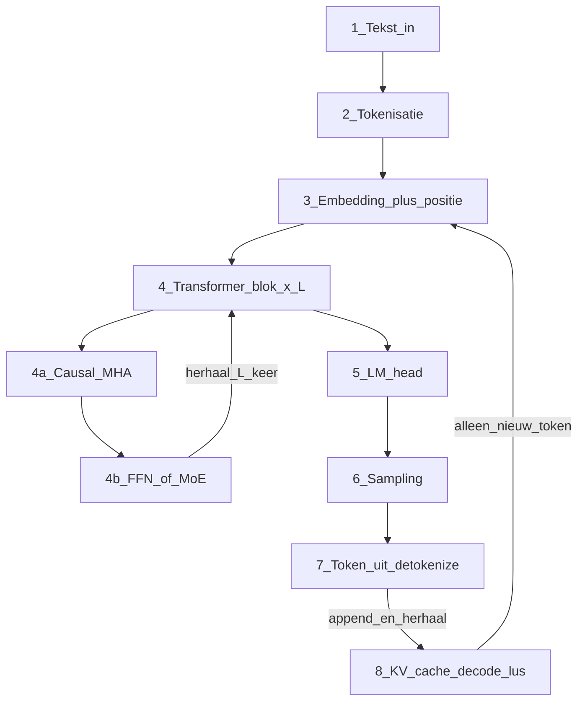

# LLM-doorloop — chronologisch schema

> **Rol:** Eén tijdlijn van tekst → tokens → lagen → volgend token (decoder-only LLM), met bronnen per stap. Basis voor latere kenniskaart-uitbreiding.
> **Niet hier:** training van scratch (pretrain/SFT/RLHF alleen als context); engines (vLLM) → [../inference](../inference/INDEX.md); HybridLink → [../redeneneren/hybrid-agents.md](../redeneneren/hybrid-agents.md).

**Samenvatting + bronnenbundel:** [bron §36](../../bronnen.md) (zoek `§36`). Gerelateerd: [transformer-basics.md](transformer-basics.md), [../inference/caching.md](../inference/caching.md).

---

## 0. Wat we schematiseren

Een **decoder-only** LLM (GPT-stijl) voorspelt het **volgende token** gegeven de tokens tot nu toe. Chronologie = pad van één forward pass, daarna de autoregressive lus.

Twee fasen bij gebruik (inferentie):

| Fase | Wat er gebeurt |
|------|----------------|
| **Prefill** | Hele prompt in één keer door het netwerk; bouw **KV-cache** |
| **Decode** | Eén nieuw token per stap; hergebruik cache; append nieuwe K/V |

Dit document volgt eerst de **architectuur-doorloop** (stappen 1–7), daarna de **generatielus** (8).

---

## 1. Chronologisch overzicht



ASCII (zelfde volgorde):

```
Tekst
  → Tokenizer (subwords / bytes → IDs)
  → Token embedding + positie (learned / RoPE / …)
  → × L  Transformer-blokken:
        residual → (norm) → causal multi-head attention → residual → (norm) → FFN/MoE
  → Final norm (vaak)
  → LM-head → logits over vocabulaire
  → Sampling (argmax / temperature / top-p / …) → token-ID
  → Detokenize → tekstfragment
  → [Decode] append ID; herhaal vanaf embedding met KV-cache
```

---

## 2. Per stap: wat + bronnen

### Stap 1–2 — Tekst → tokens

**Wat:** Finite vocabulary \(V\). Tokenizer mapte string → ID-sequentie; detokenizer omgekeerd. Meestal **subword** (BPE e.d.) of byte-level, niet hele woorden.

| Bron | Rol |
|------|-----|
| [Sennrich et al. 2016 — Neural MT with Subword Units (BPE)](https://aclanthology.org/P16-1162/) | Klassieke BPE voor NLP |
| [Kudo & Richardson 2018 — SentencePiece](https://aclanthology.org/D18-2012/) | Train/tokenize vanuit raw text; veel LLM-tooling |
| [Alammar — How Transformer LLMs Work (DeepLearning.AI)](https://www.deeplearning.ai/short-courses/how-transformer-llms-work/) | Visuele/code-intro tokenizers in LLM-context |
| [Jurafsky & Martin — SLP3, Transformers ch.](https://web.stanford.edu/~jurafsky/slp3/) | Leerboekkader token → embedding → blocks |

### Stap 3 — Embedding + positie

**Wat:** Elke ID → vector \(d\) via embedding-tabel. Positie moet erbij: anders is de sequence bag-of-tokens. Modern vaak **RoPE** (rotaties in attention) i.p.v. alleen absolute learned positions (GPT-2-stijl).

| Bron | Rol |
|------|-----|
| [Vaswani et al. 2017 — Attention Is All You Need](https://arxiv.org/abs/1706.03762) | Oorspronkelijke sinus-positie + hele Transformer |
| [Su et al. — RoFormer / RoPE](https://arxiv.org/abs/2104.09864) | Rotary position embeddings (wijdverspreid in recente LLMs) |
| [Alammar — The Illustrated Transformer](https://jalammar.github.io/illustrated-transformer/) | Stap-voor-stap visuals (encoder/decoder-origineel; intuïtie) |
| [Princeton COS514 lecture notes — LLM basics](https://princetonuniversity.github.io/princeton-cos514-fall25.github.io/LLM_basics_lectures.pdf) | Compacte math + data pathway door een block |

### Stap 4a — Causal multi-head self-attention

**Wat:** Per token: Query/Key/Value. Scores \(QK^\top/\sqrt{d_k}\), softmax, gewogen som van \(V\). **Causal mask:** positie \(t\) ziet alleen \(\le t\). Multi-head = parallelle subspaces. Residual + LayerNorm (Pre-LN in moderne GPT’s).

| Bron | Rol |
|------|-----|
| Vaswani et al. 2017 (hierboven) | Scaled dot-product, multi-head, mask |
| [Jurafsky SLP3 — Transformers PDF](https://web.stanford.edu/~jurafsky/slp3/old_aug25/8.pdf) | Decoder-only kolom + LM head in één figuur |
| [ML Handbook — Language models / GPT](https://jayanthappalla.com/ml-handbook/chapters/08-modern-deep-learning/02-language-models/) | Causal mask, teacher forcing, parameter count |

### Stap 4b — Feed-forward (of MoE)

**Wat:** Per positie een MLP (vaak expand → activatie → project terug). **Attention mengt context; FFN “verwerkt” lokaal.** MoE: router kiest experts i.p.v. één dichte FFN (meer capaciteit, minder actieve params).

| Bron | Rol |
|------|-----|
| Vaswani et al. 2017 | Position-wise FFN |
| Alammar / Grootendorst course (hierboven) | Moderne blocks + **Mixture-of-Experts** intuïtie |
| Switch / Mixtral papers (later uitdiepen in optimalisatie) | MoE-routing — stub: [../efficientie/optimalisatie.md](../efficientie/optimalisatie.md) |

### Stap 5–6 — LM-head → sampling

**Wat:** Laatste hidden state (vaak laatste positie) × unembedding → logits over \(V\). Softmax → distributie. Sampling: greedy, temperature, top-k/top-p, … Weight tying: vaak \(U \approx E^\top\).

| Bron | Rol |
|------|-----|
| Jurafsky SLP3 Transformers (LM head-sectie) | Unembedding + softmax |
| ML Handbook GPT-architecture | Tied embeddings, block layout |
| Model cards / HF `generate` docs | Praktijk sampling-parameters (later § indien nodig) |

### Stap 7 — Detokenize

**Wat:** Gekozen ID(s) → tekst. Subword-grenzen bepalen spaties/bytes; fouten hier ≠ “model denkt fout”.

| Bron | Rol |
|------|-----|
| SentencePiece paper | Encode/decode contract |
| HF Tokenizers docs | Praktijk in LLM-stacks |

### Stap 8 — Prefill, decode, KV-cache

**Wat:** Zonder cache zou elke nieuwe token de hele prefix opnieuw door attention jagen. **KV-cache** bewaart Keys/Values per laag voor eerdere tokens; bij decode alleen nieuw token projecteren en Q laten attenden op cache + nieuw.

| Bron | Rol |
|------|-----|
| [D2L — Generation and the KV Cache](https://d2l.smola.org/chapter_transformers/kv-cache.html) | Van recompute naar cache; rekenkunde |
| [Raschka FAQ — What is a KV cache?](https://sebastianraschka.com/faq/docs/kv-cache.html) | Kort, precies, prefill vs decode |
| [Baseten — LLM Inference Mechanics](https://www.baseten.co/inference-engineering/book/02-models/llm-inference-mechanics/) | Attention + cache in serving-context |
| §29 + [../inference/caching.md](../inference/caching.md) | Engines / prefix-cache (Agent Engineering-hoek) |

---

## 3. Overzichtsbronnen (hele schema in één keer)

Gebruik deze om het plaatje te *leren*; de tabel hierboven om per onderdeel te *verdiepen*.

| Bron | Type | Waarom |
|------|------|--------|
| [How Transformer LLMs Work](https://www.deeplearning.ai/short-courses/how-transformer-llms-work/) (Alammar, Grootendorst, Ng) | Cursus ~90 min | Token → blocks → head → cache → MoE; modern |
| [The Illustrated Transformer](https://jalammar.github.io/illustrated-transformer/) | Essay + figuren | Klassieke intuïtie Attention Is All You Need |
| [Hands-On Large Language Models](https://www.llm-book.com/) (zelfde auteurs; boek) | Boek | Uitgebreide update van de illustrated-lijn |
| [Attention Is All You Need](https://arxiv.org/abs/1706.03762) | Paper | Primaire definitie |
| [Jurafsky & Martin SLP3](https://web.stanford.edu/~jurafsky/slp3/) | Leerboek | Academische doorlopende uitleg |
| [Princeton LLM basics lecture PDF](https://princetonuniversity.github.io/princeton-cos514-fall25.github.io/LLM_basics_lectures.pdf) | College | Dichte math + block pathway |
| [ML Handbook — Language models](https://jayanthappalla.com/ml-handbook/chapters/08-modern-deep-learning/02-language-models/) | Notes | GPT-layout + causal LM training |

---

## 4. Wat dit níet is (nog)

| Onderwerp | Waar later |
|-----------|------------|
| Pretraining / SFT / RLHF chronologie | Nieuw stub of aparte pagina onder `modellen/` |
| Speculative decoding | [../efficientie/optimalisatie.md](../efficientie/optimalisatie.md) |
| Latent i.p.v. text tokens | [../redeneneren/hybrid-agents.md](../redeneneren/hybrid-agents.md) |
| RAG vóór de prompt | [../retrieval/rag.md](../retrieval/rag.md) |

---

## 5. Naar de mind map

Elke stap hierboven = **knoop**. Voor de hand liggende randen:

- Tokenisatie → contextlengte / kosten (P1)
- Attention ↔ KV-cache ↔ VRAM ([lokaal-hardware](../inference/lokaal-hardware.md))
- FFN/MoE ↔ optimalisatie
- Sampling ↔ “determinisme” / eval in `meten/`

Werk boomtakken bij in [../kenniskaart-outline.md](../kenniskaart-outline.md) en diepte/randen in [../kenniskaart.md](../kenniskaart.md) wanneer deze pagina “diep genoeg” is (nu: schema + bronnen = **outline→diep** voor de doorloop).

---

## Wat kan naar de standaard

**Geen actie.** Dit is spoor-2 begrip; AGENTS.md hoeft geen transformer-uitleg.

## Geen actie (kit)

Geen.
