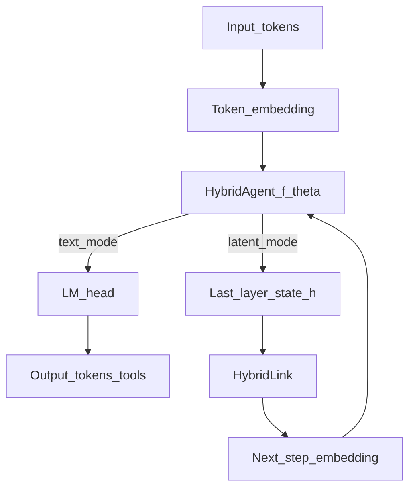

# Hybrid Reasoning Agents

> **Rol:** Diepe uitleg van hybrid / latent reasoning: mechanisme, training, trade-offs, en wat dat betekent voor Agent Engineering.
> **Niet hier:** de korte samenvatting (die staat in [bron §35](../../bronnen.md); zoek `§35`), of kit-instructies.

**Bronnen:** Zou et al., *Hybrid Reasoning Agents* (Stanford / together.ai / UIUC / Meta, preprint okt 2026); Hugging Face `togethercomputer/HybridAgent-14B-Agentic` (en 8B); arXiv-achtige referentie in de modelkaart. Samenvatting: §35.

---

## 1. Probleem dat de paper aanvalt

Klassieke LLM-agents **redeneren in tekst**: chain-of-thought, tool-calls, multi-turn prose. Dat is:

- **transparant** (je kunt meelezen) en **native tool-bruikbaar** (JSON/XML/tags in de output);
- maar **duur**: elk denk-token kost latency, geld en contextruimte.

**Latent reasoning** (denken in verborgen vectoren / continuous space) is sneller en tokenarmer, maar mist van nature:

- stabiele tool-interfaces (tools verwachten tekst);
- menselijke audit (“wat dacht het model?”).

HybridAgents willen **beide** in één generatieproces: dynamisch wisselen tussen latent “denken” en text “handelen”.

---

## 2. Architectuur in één plaatje

### 2.1 Text mode

Gewone autoregressieve generatie: verborgen staat → LM-head → discrete tokens. Hier gebeurt alles wat de buitenwereld moet zien: antwoorden, tool-calls, zoekqueries, Python.

### 2.2 Latent mode

Speciale tokens (typisch `<latent>` … `</latent>`) schakelen de lus om:

1. Neem de last-layer state \(h\).
2. Map die via een lichte **HybridLink** terug naar een embedding voor de volgende positie — **zonder** LM-head / discrete token.
3. Herhaal: het model “denkt” in continuous space.

**HybridLink (schets):** lineair \(W_1\) → GELU → lineair \(W_2\), plus residual op \(h\), zodat \(\mathcal{R}(h)\) als next-step embedding dient. De link is klein t.o.v. het backbone-model (aparte `adapter.pt` / `adapter_config.json` in de HF-release).

### 2.3 Waarom dit geen “ander product” is dan een transformer

De backbone blijft een standaard decoder (hier o.a. Qwen2-14B-Base → HybridAgent-14B-Agentic). Wat nieuw is:

- mode-tokens en de HybridLink-lus;
- training die leert **wanneer** latent vs text zinvol is;
- inference-engine die latent stappen uitvoert i.p.v. alleen token-sampling.

---

## 3. Leren: HybridSFT en HybridRL

| Fase | Doel |
|------|------|
| **HybridSFT** | Supervised traces waarin latent-blokken en text/tool-blokken correct geplaatst zijn; het model leert de *vorm* van hybrid trajecten |
| **HybridRL** | Versterken van beleid: beloon goede uitkomsten én efficiëntie (minder onnodige text-tokens), straf misplaatste mode-switches |

Kernvaardigheid is niet alleen “goed antwoorden”, maar **mode-selectie**: wanneer is latent genoeg, wanneer moet er tekst/tool uit?

Claimcijfers uit de paper/abstract (niet zelf gereproduceerd; zie origineel): orde **~10%** betere agent-prestatie t.o.v. frontier text-agents in hun setup; **~35–55%** minder tokens; **~1.8–2.6×** snellere inferentie; **~2.7–3.7×** lagere kosten. Behandel als *claims van de auteurs*, niet als kit-garantie.

---

## 4. Interpretability: latent → pseudo-text

Elke latent stap kan worden **uitgelezen** als pseudo-tekst (readout), zodat “gedachten” inspecteerbaar blijven zonder dat die tokens in de normale output hoeven te zitten. De HF-kaart noemt o.a. een interpretability-pad (`interpretable_latent_mode` → HTML-rapport).

Relevant voor engineering: **audit zonder always-on CoT in de user-facing stream** — hetzelfde probleem dat Agent Engineering heeft met “alles uitleggen in AGENTS.md” vs. logs achteraf.

---

## 5. Agentische inzet (HF Agentic-checkpoint)

Het agentic-checkpoint combineert hybrid generatie met tools (o.a. Python-interpreter, web search) over meerdere beurten en shared working memory. Tool-verkeer blijft **text mode**; planning/zoeken in het probleem mag **latent** wanneer geleerd.

Dit verandert **niet** automatisch je Cursor-/Claude-workflow: die harness praat met text-APIs. Hybrid is een **ander model + inference-pad**, geen drop-in voor `AGENTS.md`.

---

## 6. Wat dit níet is voor deze repo

| Misverstand | Feit |
|-------------|------|
| “Installeer HybridAgent in bootstrap” | Spoor 1 optimaliseert de **omgeving** rond bestaande tools; weights horen niet in de kit |
| “Vervang LLMs door hybrid overal” | Alleen zinvol waar je het model én de engine controleert (eigen serving, batch jobs) |
| “Latent = gratis” | Latent kost compute; winst zit in minder *text*-tokens en soms latency — meet het |
| “Nieuwe agent-taal / DSL nodig” | Mode-tags zijn modelintern; jouw projectdocs blijven imperatieven + pointers (P2) |

---

## 7. Vertaling naar Agent Engineering (analogieën)

| Hybrid-idee | Omgevingsles (spoor 1) | Bestaande ankers |
|-------------|------------------------|------------------|
| Latent = goedkoop denken; text = duur handelen | Houd always-on context kort; essays horen niet in AGENTS | P2, P25 |
| `<latent>` / `</latent>` mode-switch | Expliciete fases in skills: onderzoek → pas daarna plan; verberg future goals | §3 |
| HybridLink: state → volgende stap zonder dump | Dunne router; zware kennis JIT via kaart/grep | P2, §10 |
| Pseudo-text readout | Meet/log “waarom”; niet alles in de live prompt | `meten/`, P27 |
| Token↓ / cost↓ | Zelfde metrics als bachelorproef: tokens, duur, slaagkans | P25, P26 |

Zie ook de [kenniskaart](../kenniskaart.md) (randen Hybrid ↔ tokens ↔ AGENTS) en [drie hefbomen](../efficientie/drie-hefbomen.md) (reasoning-mode als derde as).

---

## Wat kan naar de standaard

Kandidaten — **nog niet** als nieuw principe of kit-default, tot deletion test / meting:

1. **Geen actie op weights/serving** in kit of bootstrap.
2. **Wel behouden / versterken in docs (geen nieuwe P):** analogie “denken vs handelen” in fundament + kenniskaart; bestaande P2/P25 dekken de les.
3. **Optioneel later meten:** skill met strikte fase-splitsing vs. één lange CoT-prompt — effect op tokens/slaagkans (`meten/`), geïnspireerd door mode-switch.
4. **Geen** always-on `.mdc` met Hybrid-jargon; **geen** kunstmatige agent-syntax als standaard.

## Geen actie (kit)

Geen wijziging aan `kit/`, geen HybridAgent-dependency, geen P28 enkel op basis van deze paper.
