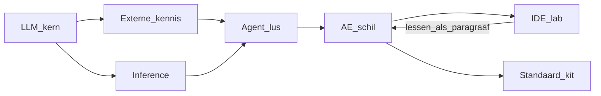

# Tour — één verhaal: LLM → agent → IDE-lab → standaard

> **Rol:** Doorlopend narratief om alles in je hoofd te plaatsen. Begint bij het model, schakelt door naar agents, Agent Engineering en het IDE-lab. Verwijst; kopieert geen § of P.
> **Niet hier:** feiten met URL ([bronnen.md](bronnen.md)); principes als lijst ([principes.md](principes.md)); diepe lesstof ([fundament/](fundament/INDEX.md)); lab-status (zie `cardine/docs/research/RESEARCH.md`, sibling-repo niet in checkout).

Lees dit **één keer** als landkaart. Daarna: bij twijfel “waar hoort X?” → tabel onderaan; bij “hoe werkt X?” → de gelinkte pagina.



---

## 1. Het model: tekst in, volgende token uit

Een LLM is geen zoekmachine en geen database. Het is een netwerk dat, gegeven wat er tot nu toe staat, het **volgende token** voorspelt — en dat herhaalt tot een stop.

Chronologie van één stap (decoder-only, GPT-stijl):

1. Tekst → **tokenizer** → IDs  
2. IDs → **embeddings** (+ positie) → vectoren  
3. Door **L transformer-blokken**: vooral **attention** (wie mag naar wie kijken in de context) + FFN/MoE  
4. **LM-head** → scores over het vocabulaire → sampling → nieuw token  
5. Append, herhaal (**autoregressive** lus)

**Attention** is het mechanisme waarmee elk token “gewicht” geeft aan eerdere tokens in het venster. **Transformer** is de stapel blokken die dat (plus feed-forward) herhaalt. Zonder die stapel geen modern LLM; zonder attention geen bruikbare contextgevoeligheid binnen het venster.

Diepte: [fundament/modellen/llm-doorloop.md](fundament/modellen/llm-doorloop.md) (§36). Ingang: [transformer-basics](fundament/modellen/transformer-basics.md).

Twee fasen bij gebruik: **prefill** (hele prompt in één keer, bouw KV-cache) en **decode** (één token per stap, hergebruik cache). Dat is geen apart “soort AI” — het is hoe dezelfde doorloop efficiënt herhaald wordt.

---

## 2. Wat het model *niet* heeft (en waarom RAG bestaat)

Gewichten = wat het tijdens training ongeveer leerde. **Contextvenster** = wat je *nu* in de prompt stopt. Daarbuiten ziet het model niets.

Daarom bestaan er bruggen naar buiten:

| Brug | Wat het doet | Waar in dit plan |
|------|----------------|------------------|
| **Langere / betere context** | Meer of relevantere tokens in het venster | Context engineering (§8–§10, §17–§18) |
| **Embeddings + retrieval (RAG)** | Vraag → vectoren → zoek stukken docs → plak in de prompt | [fundament/retrieval](fundament/retrieval/INDEX.md) |
| **Tools** | Model vraagt om actie (zoeken, shell, API); runtime voert uit; resultaat terug in context | [fundament/agents](fundament/agents/INDEX.md) |
| **Memory buiten de chat** | Persistente bank of bestanden over sessies heen | o.a. §52; lab-spine A9 |

**Embeddings** zijn vectoren die betekenis-nabijheid benaderen. **RAG** is het patroon: haal relevante stukken op, stop ze in de context, laat het model antwoorden *alsof* die stukken “geweten” waren. RAG vervangt training niet; het vult het gat tussen gewichten en *jouw* actuele feiten.

Zelfde idee, andere vorm: een coding-agent die `rg` of files opent, doet retrieval via tools i.p.v. via een vectorstore — nog steeds “externe kennis in het venster”.

---

## 3. Inference: het model moet ergens *draaien*

Training ≠ gebruik. Bij gebruik (API of lokaal) bepaalt de **inference-stack** snelheid, VRAM, prijs:

- Engines (`vLLM`, `SGLang`, `llama.cpp`, …)  
- **KV-cache** / prompt-cache (niet twee keer dezelfde prefill betalen)  
- Quantisatie, MoE-streaming, hardwaregrenzen  

Dit is de laag “hoe duur/snel is één token?” — niet “hoe schrijf ik AGENTS.md?”. Kaart: [fundament/inference](fundament/inference/INDEX.md); hefbomen: [efficientie](fundament/efficientie/INDEX.md).

Open weights vs API: [open-modellen](fundament/open-modellen/INDEX.md). Lab-default vandaag: API eerst (DeepSeek e.d.); lokaal later — zie Cardine-onderzoek A3.

---

## 4. Van model naar *agent*

Een chat-LLM antwoordt in tekst. Een **agent** mag **tools** gebruiken en in een **lus** blijven tot een stopconditie: lezen → denken → handelen → observeren → …

```
mens / taak
    → prompt + context (docs, files, tool-resultaten)
        → model (volgende token / tool-call)
            → harness voert tool uit of weigert
                → resultaat terug in context
                    → opnieuw tot klaar of fail
```

Zonder lus en tools blijft het “slimme autocomplete”. Met lus zonder meetbare stop en zonder harde grenzen krijg je comprehension debt en slop ([principes](principes.md) P13, P22, P27).

Orchestratie, MCP/skills, multi-agent-grafen: [fundament/agents](fundament/agents/INDEX.md); praktijk in bronnen onder Graph / Harness / Loop ([bronnen-index](bronnen-index.md)).

---

## 5. Agent Engineering: de schil om het model

Het model is de motor. **Agent Engineering** is alles eromheen zodat die motor in *jouw* repo nuttig en veilig werkt. Raamwerk (vier lagen, onderop → bovenop in de stack):

| Laag | Vraag | Voorbeelden bij jou |
|------|--------|---------------------|
| **Prompt** | Welke instructie / skill / toon? | Skills, leading words, geen Skill Hell (§3, §54) |
| **Context** | Wat mag het model *zien*? | Kleine router, INDEX, just-in-time docs (P1–P4) |
| **Harness** | Wat mag het *doen*, en hoe krijgt het feedback? | Hooks, sandbox, `make check`, permissions (P13–P14) |
| **Loop** | Hoe herhaalt het tot “af”, met geheugen buiten de chat? | Specs, spine/files, stopconditie (P27) |

Daarboven: workflow (grill → spec → slices), software design (deep modules, anti-slop), agent-docs (AGENTS.md, ADR, Diátaxis). Dat is de **kernpraktijk** in [bronnen-index](bronnen-index.md).

**Principes (P1–P28)** zijn de korte wetten die uit die bronnen volgen: context is eindig, één feit één plaats, verifieerbaar > “lijkt af”, intent expliciet, enz. Lees [principes.md](principes.md) nadat dit verhaal zit — dan plakken de P’s op lagen i.p.v. als losse regels.

**Spoor 1** = die schil *leveren* aan elk project via kit/bootstrap.  
**Spoor 2** = *begrijpen* waarom (deze map: §, P, fundament, deze tour).

```
idee / video / claim
  → inbox (niet kwijtraken)
  → § in bronnen (feiten)
  → eventueel fundament (diepte)
  → brug: mag het naar kit? → pas dan spoor 1
```

---

## 6. Cardine: waar je de schil *bouwt en meet* (spoor 3)

`cardine` (sibling-repo, niet in deze checkout) is geen tweede catalogus van LLM-theorie. Het is het **lab**: minimale coding-harness + standaard, later mogelijk product. Domeinen in het lab (jargon: `cardine/docs/context/GLOSSARY.md`):

- **harness** — de agent-loop en tool-schil (vergelijk Pi, Cursor, DSH — A1/A2)  
- **structure** — waar policy leeft: docs vs code vs dual (A6)  
- **indexing** — hoe de agent de codebase vindt (regex-first vs embeddings — §69/§70)

Onderzoeksvragen en volgorde: `cardine/docs/research/RESEARCH.md` + `cardine/docs/research/ideas-and-questions.md`.
Lessen die hard genoeg zijn → terug als **§ in `kit/`** (één feitenbron), niet gedupliceerd in het lab.

Relatie in één zin: **AE leert en standaardiseert de schil; het lab experimenteert tot iets meetbaar genoeg is om te standaardiseren of bewust weg te laten.**

---

## 7. Hoe het één geheel is

| Als je dit tegenkomt… | …zit het hier in het verhaal | …open dit |
|------------------------|------------------------------|-----------|
| Attention, transformer, tokens | §1 modelkern | [llm-doorloop](fundament/modellen/llm-doorloop.md) |
| Embeddings, vector DB, RAG | §2 externe kennis | [retrieval](fundament/retrieval/INDEX.md) |
| vLLM, VRAM, quantisatie | §3 inference | [inference](fundament/inference/INDEX.md) |
| Tool-calls, MCP, multi-agent | §4 agent | [agents](fundament/agents/INDEX.md) |
| AGENTS.md, hooks, `make check`, slices | §5 AE-schil | [principes](principes.md), [bronnen-index](bronnen-index.md) |
| Cursor vs Pi, dual structure, spine | §6 lab | `cardine/docs/research/ideas-and-questions.md` (sibling-repo) |
| Kit, bootstrap, GymFreak | spoor 1 leveren | [README](../README.md), [brug](fundament/brug.md) |
| Reels / claims / nieuwe tools | nog geen plek | [inbox](inbox.md) → later § |

Conceptkaart (knopen, geen verhaal): [kenniskaart](fundament/kenniskaart.md) + `make mindmap`.  
Catalogus van bronnen: [bronnen-index](bronnen-index.md).  
Ruwe signalen: [inbox](inbox.md).

---

## 8. Mini-wandeling (15 min)

1. Dit bestand tot hier.  
2. Schets in [llm-doorloop](fundament/modellen/llm-doorloop.md) (mermaid + ASCII).  
3. Skim [principes](principes.md) sectie A–E — koppel elke sectie aan een laag uit §5.  
4. Open `cardine/docs/research/ideas-and-questions.md` (sibling-repo) A1–A5 werkantwoorden — zie lab als "AE in het wild meten".
5. Bij het volgende begrip dat je niet kunt plaatsen: rij in de tabel hierboven; zo niet → inbox of vraag.

Daarna hoef je niet alles te *kennen*; je moet alles kunnen *plaatsen*.
