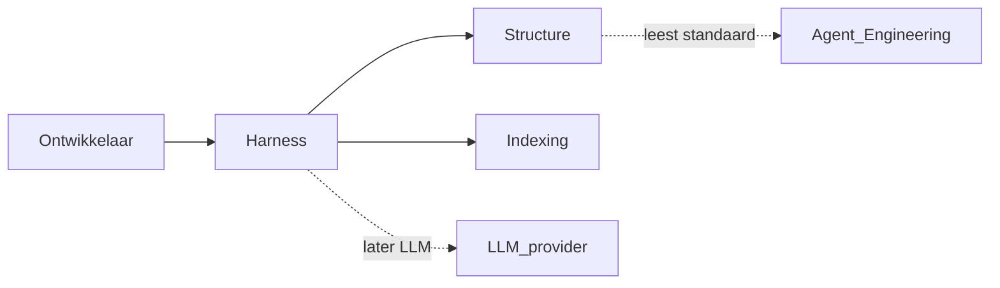

# Architectuur

> **Rol:** Hoe het systeem in elkaar zit op containerniveau. Diepte per subsysteem: zie de links onderaan.
> **Niet hier:** mappenboom (`ls`), codedetails (de code), het waarom (`decisions/`), PWA/offline/push/chrome-poll, auth-flows en feature-catalogus — die horen in `architecture/<subsysteem>.md` (bv. `runtime-client.md`, `auth.md`).

## Systeemcontext

Het product is de projectstructuur plus een gids ([PRODUCT.md](../product/PRODUCT.md), [ADR 0009](../decisions/0009-het-product-is-de-gratis-projectstructuur-en-een-gids-naar-de-agent-paden.md)). Deze pagina beschrijft de containers van het lab-pad: Zed + DeepSeek Harness met een API-key ([totaalproduct.md](../product/totaalproduct.md)). Externe systemen: Agent_Engineering (kit + bron, alleen lezen en verwijzen) en, op dit pad, LLM-providers via eigen API-keys. Geen prod-hosting in de labfase.

## Containers

Nog geen app-stack. Geplande containernamen (pad/poort na runtime-keuze):

| Container | Pad | Taak | Poort lokaal | Host in productie |
|-----------|-----|------|--------------|-------------------|
| harness | `apps/…` (na runtime-keuze) | Agent-loop, metingen, experiment-entry | n.n.b. | geen (lokaal lab) |
| structure | zelfde app of module | Standaard lezen/afdwingen | — | — |
| indexing | zelfde app of module | Code-/context-index | — | — |

Geen database tot een ADR dat nodig acht. `structure` en `indexing` zijn **domeinen**, geen aparte deployables tenzij later besloten.

## Stack

| Laag | Keuze | Waarom (ADR) |
|------|-------|--------------|
| Runtime / apps | *open* | [0001](../decisions/0001-runtime-stack-bewust-uitgesteld-tot-expliciete-pi-of-ts-keuze.md) |
| Database | geen | Lab heeft geen user-data-writer tot ADR anders zegt |
| Hosting | lokaal (lab) | Prod/portfolio-deploy pas na productisatie ([RULES.md](../rules/RULES.md)) |
| LLM | eigen keys; DeepSeek-richting | Goedkoop voor lab; andere providers via config, geen lock zonder ADR |

Extra taal / native hot path (Rust, C, …): niet in deze tabel zetten zonder ADR. Beslisboom: [polyglot.md](polyglot.md). Voorbeeld-ADR: [0000-voorbeeld-native-module-na-budget-breuk.md](../decisions/0000-voorbeeld-native-module-na-budget-breuk.md).

## Dataflow en eigenaarschap

- Geen overname van data/secrets uit andere projecten.
- Lab-artefacten (experimentoutput, index-cache): onder `data/` volgens [data/README.md](../../data/README.md); raw/runtime nooit in git of antwoorden.
- Agent_Engineering: alleen lezen/verwijzen; deze repo schrijft daar niet naartoe via de harness (mens commit §’s in bron). De publieke structure-package pullt die bron en kopieert de standaard niet ([ADR 0013](../decisions/0013-cardine-is-het-publieke-uithangbord-en-pullt-de-structure-uit-agent-engineering.md)).

## Hosting en poorten

Alles lokaal. Geen productiedomeinen. Poorten volgen uit `apps/*/app.mk` zodra er een stack is.

## Wat in git staat

Niets afwijkends van de standaard tot er demo-/reference-datasets zijn. Geen secrets, geen `data/raw` of `data/runtime`.

## Invarianten

- Geen stack-generators of stack-ADR tot expliciete runtime-keuze (BACKLOG + deze sectie).
- Domeingrenzen `harness` / `structure` / `indexing` blijven de enige productdomeinen tot PRODUCT.md wijzigt.
- Lessen uit het lab → eerst § in Agent_Engineering `bron/`, niet hier dupliceren.

## Seams (naden)

| Seam | Wat erover gaat | Bewaakt door |
|------|-----------------|--------------|
| harness → structure | Welke standaardpaden/regels de loop mag lezen of afdwingen | nog te beveiligen (contracttest na stack) |
| harness → indexing | Welke indexqueries de loop mag doen; geen raw secrets in index | nog te beveiligen |
| structure → Agent_Engineering | Read-only paden (kit/bron); geen write vanuit lab-code | conventie + RULES; later pad-allowlist-test |
| harness → LLM | Prompts/context via eigen API-key (DeepSeek e.d.); geen keys of vreemde projectdata in logs/index | nog te beveiligen (redaction + `.env`) |

- **Mag een agent zonder akkoord:** docs invullen binnen bestaande bestanden; code *binnen* een bestaande domeinmodule achter een stabiele interface (pas na stack).
- **Eerst vragen of ADR:** runtime/stack-keuze, nieuwe app-map, database, gedeelde `utils/`, seam verplaatsen, prod-achtige hosting.

## Subsystemen

- [polyglot.md](polyglot.md) — Wanneer native/extra taal mag; FFI vs sidecar; wat de agent mag.
- [security.md](security.md) — Secrets, auth-principes, Strix; lab heeft nu minimale PII.
- [observability.md](observability.md) · [performance.md](performance.md) · [dependencies.md](dependencies.md) — alleen bij die opdracht (via INDEX). Budgets/tooling: BACKLOG tot er een app is.
