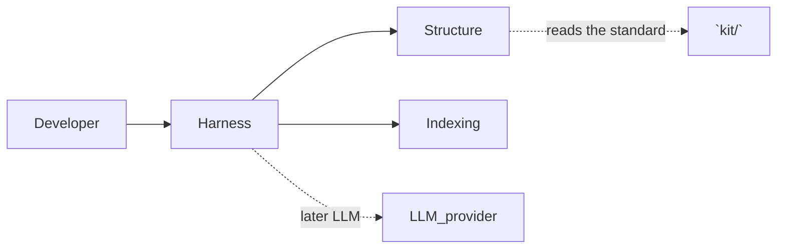

# Architecture

> **Role:** how the system fits together at container level. Depth per subsystem: see the links at the bottom.
> **Not here:** the directory tree (`ls`), code details (the code), the why (`decisions/`), PWA/offline/push/chrome-poll, auth flows and the feature catalogue — those belong in `architecture/<subsystem>.md` (e.g. `runtime-client.md`, `auth.md`).

## System context

The product is the project structure plus a guide ([PRODUCT.md](../product/PRODUCT.md), [ADR 0009](../decisions/0009-the-product-is-the-free-project-structure-and-a-guide-to-the-agent-paths.md)). This page describes the containers of the lab path: Zed + DeepSeek Harness with an API key ([totaalproduct.md](../product/totaalproduct.md)). External systems: `kit/` (kit + sources, read and reference only) and, on this path, LLM providers through your own API keys. No prod hosting in the lab phase.

## Containers

No app stack yet. Planned container names (path/port after the runtime choice):

| Container | Path | Task | Port locally | Host in production |
|-----------|------|------|--------------|--------------------|
| harness | `apps/…` (after the runtime choice) | Agent loop, measurements, experiment entry | t.b.d. | none (local lab) |
| structure | same app or module | Read/enforce the standard | — | — |
| indexing | same app or module | Code/context index | — | — |

No database until an ADR calls for one. `structure` and `indexing` are **domains**, not separate deployables unless decided later.

## Stack

| Layer | Choice | Why (ADR) |
|-------|--------|-----------|
| Runtime / apps | *open* | [0001](../decisions/0001-runtime-stack-deliberately-deferred-until-an-explicit-pi-or-ts-choice.md) |
| Database | none | The lab has no user-data writer until an ADR says otherwise |
| Hosting | local (lab) | Prod/portfolio deploy only after productisation ([RULES.md](../rules/RULES.md)) |
| LLM | own keys; DeepSeek direction | Cheap for the lab; other providers via config, no lock without an ADR |

An extra language / native hot path (Rust, C, …): do not put it in this table without an ADR. Decision tree: [polyglot.md](polyglot.md). Example ADR: [0000-example-native-module-after-budget-breach.md](../decisions/0000-example-native-module-after-budget-breach.md).

## Dataflow and ownership

- No taking over data/secrets from other projects.
- Lab artefacts (experiment output, index cache): under `data/` per [data/README.md](../../data/README.md); raw/runtime never in git or in answers.
- `kit/`: read/reference only; this repo does not write there through the harness (a human commits §s into the sources). The public structure package mirrors that source and does not copy the standard ([ADR 0013](../decisions/0013-cardine-is-the-public-shop-window-and-pulls-the-structure-from-agent-engineering.md)).

## Hosting and ports

Everything local. No production domains. Ports follow from `apps/*/app.mk` once there is a stack.

## What is in git

Nothing deviating from the standard until there are demo/reference datasets. No secrets, no `data/raw` or `data/runtime`.

## Invariants

- No stack generators or stack ADRs until an explicit runtime choice (BACKLOG + this section).
- Domain boundaries `harness` / `structure` / `indexing` remain the only product domains until PRODUCT.md changes.
- Lessons from the lab → first a § in `bron/`, do not duplicate them here.

## Seams

| Seam | What passes over it | Guarded by |
|------|---------------------|------------|
| harness → structure | Which standard paths/rules the loop may read or enforce | still to be secured (contract test after the stack) |
| harness → indexing | Which index queries the loop may run; no raw secrets in the index | still to be secured |
| structure → `kit/` | Read-only paths (kit/sources); no writes from lab code | convention + RULES; later a path allowlist test |
| harness → LLM | Prompts/context via your own API key (DeepSeek etc.); no keys or foreign project data in logs/index | still to be secured (redaction + `.env`) |

- **An agent may without approval:** fill in docs within existing files; code *inside* an existing domain module behind a stable interface (only after the stack).
- **Ask first or file an ADR:** runtime/stack choice, a new app directory, a database, shared `utils/`, moving a seam, prod-like hosting.

## Subsystems

- [polyglot.md](polyglot.md) — when native/an extra language is allowed; FFI vs sidecar; what the agent may do.
- [security.md](security.md) — secrets, auth principles, Strix; the lab currently has minimal PII.
- [observability.md](observability.md) · [performance.md](performance.md) · [dependencies.md](dependencies.md) — only for that task (via INDEX). Budgets/tooling: BACKLOG until there is an app.
