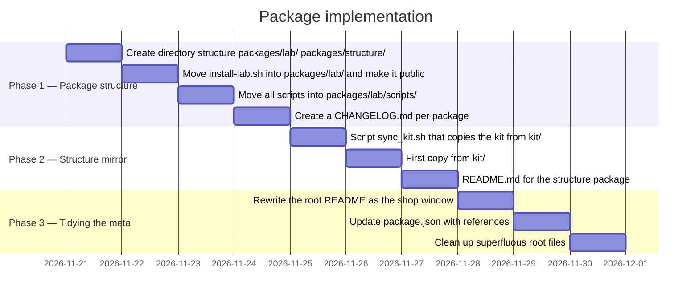

# Implementation plan — Cardine packages

> Phases and planning for setting up the public packages.
> **Status:** completed — the packages are published on npm.

## Phase 1 — Package structure

| Task | Duration |
|------|----------|
| Create the directory structure `packages/lab/`, `packages/structure/` | 1 day |
| Move `install-lab.sh` into `packages/lab/` and make it public | 1 day |
| Move all scripts into `packages/lab/scripts/` | 1 day |
| Create a CHANGELOG.md per package | 1 day |

## Phase 2 — Structure mirror

| Task | Duration |
|------|----------|
| Script `sync_kit.sh` that copies the kit from `kit/` | 1 day |
| First copy from `kit/` | 1 day |
| README.md for the structure package | 1 day |

## Phase 3 — Tidying the meta

| Task | Duration |
|------|----------|
| Rewrite the root README as the shop window | 1 day |
| Update `package.json` with references | 1 day |
| Clean up superfluous root files | 1 day |

## Timeline

