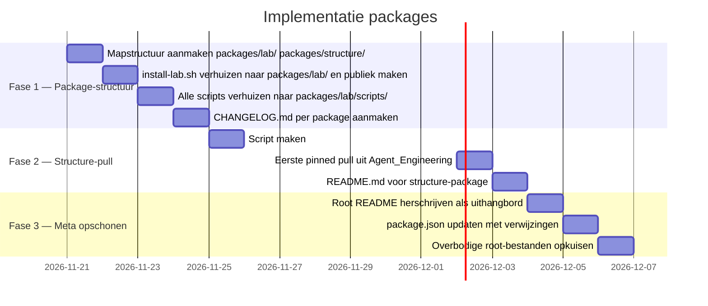

# Implementatieplan — Cardine packages

> Fasen en planning voor het opzetten van de publieke packages.
> **Status:** nog niet gestart — wacht op ontwerp-goedkeuring.

## Fase 1 — Package-structuur

| Taak | Duur |
|------|------|
| Mapstructuur aanmaken `packages/lab/`, `packages/structure/` | 1 dag |
| `install-lab.sh` verhuizen naar `packages/lab/` en publiek maken | 1 dag |
| Alle scripts verhuizen naar `packages/lab/scripts/` | 1 dag |
| CHANGELOG.md per package aanmaken | 1 dag |

## Fase 2 — Structure-pull

| Taak | Duur |
|------|------|
| Script maken: `pull_kit.sh` dat kit uit Agent_Engineering kopieert | 1 dag |
| Eerste pinned pull uit Agent_Engineering | 1 dag |
| README.md voor structure-package | 1 dag |

## Fase 3 — Meta opschonen

| Taak | Duur |
|------|------|
| Root README herschrijven als uithangbord | 1 dag |
| `package.json` updaten met verwijzingen | 1 dag |
| Overbodige root-bestanden opkuisen | 1 dag |

## Tijdlijn

