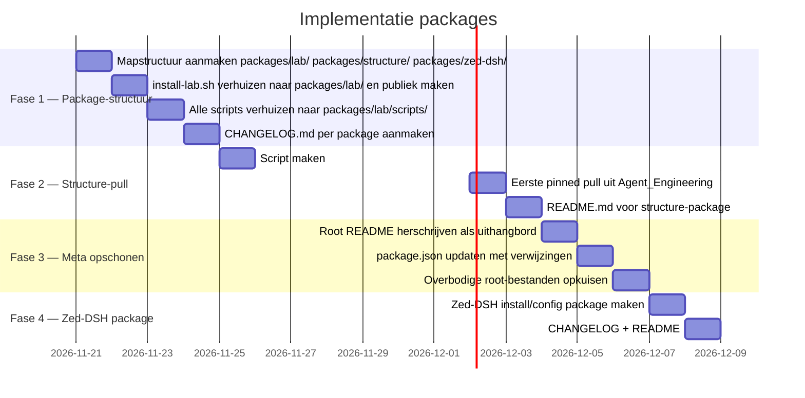

# Packages — ontwerp

> **Rol:** Centraal document voor de indeling, inhoud en versiebeheer van alle Cardine-packages.
> Dit document beschrijft het *plan*: welke packages, wat erin zit, hoe ze samenhangen, en hoe we versies bijhouden. Implementatie volgt pas nadat dit plan is goedgekeurd.
> **Niet hier:** de code van de packages zelf, de Agent_Engineering kit-inhoud, of de implementatiedetails van installatie-scripts.

## Status

| Fase | Status |
|------|--------|
| Ontwerp | ✅ **in uitvoer** |
| Goedkeuring | ⏳ wacht op review |
| Implementatie | ⏳ nog niet gestart |

---

## 1. Overzicht: welke packages

| # | Package | Doelgroep | Bron (repo) | Installatievorm |
|---|---------|-----------|-------------|-----------------|
| 1 | **`cardine-lab`** | Wie een AI-agent-werkstation wil op Arch/Hyprland | `cardine/packages/lab/` | `curl … | bash`, of npm, of AUR |
| 2 | **`cardine-structure`** | Iedereen die een projectstandaard wil (elke editor) | gepullt uit `Agent_Engineering/kit/` | `npx cardine-structure`, zip/tarball, of `new-project.sh` |
| 3 | **`cardine-zed-dsh`** | Wie Zed + DeepSeek Harness met API-key wil | `cardine/packages/zed-dsh/` | config-script, of npm |
| 4 | **`cardine`** (meta) | Iedereen die op de GitHub repo landt | `cardine/` (root) | verwijst naar 1, 2, 3; geen eigen code |

### Later (ADR 0010, optioneel)

| # | Package | Doelgroep |
|---|---------|-----------|
| 5 | **`cardine-zed-claude`** | Wie Claude Pro/Max in Zed wil |
| 6 | **`cardine-zed-chatgpt`** | Wie ChatGPT Plus/Pro in Zed wil |

Deze twee worden pas uitgewerkt als er vraag naar is. Ze vallen buiten dit ontwerp.

---

## 2. Package 1: `cardine-lab`

### Doel

Installeer een reproduceerbaar AI-agent-werkstation op een verse Arch Linux / Hyprland-machine: toolchain, sandbox, indexering, editor-koppeling.

### Wat zit erin (uit `cardine/scripts/`)

| Bestand | In package | Opmerking |
|---------|-----------|-----------|
| `install-lab.sh` | ✅ | Hoofdscript — idempotent, installeert DSH + Jarvis + bwrap + Zed-config |
| `cardine-bwrap` | ✅ | Strakkere bwrap-kooi voor de agent-shell (ADR 0007) |
| `cardine-slice-check/` | ✅ | Node-module voor `make check` na een turn |
| `cardine-status.sh` | ✅ | Status-check voor DSH, Jarvis, tools |
| `systemd/*` | ✅ | Timer-units voor digest, etc. |
| `install-digest-timers.sh` | ✅ | Timer-installatie |
| `digest-*` scripts | ✅ | Digest-fetch/propose/week (onderdeel van research-module) |
| `deps-audit.sh`, `security-scan.sh`, `perf-check.sh`, `polyglot-check.sh`, `radar-*`, `native-ffi.sh`, `check-links.sh` | ✅ | Tool-scripts (worden naar project gekopieerd via structure) |

### Wat is NIET voor publiek (blijft in Agent_Engineering privé)

| Bestand | Reden |
|---------|-------|
| Persoonlijke paden in `install-lab.sh` (bv. `REPO_ROOT` naar Agent_Engineering) | Moet generiek gemaakt worden |
| Harde paden naar `/home/ventje/` | Moet `$HOME`-relatief zijn in publieke versie |
| DSH-profiel met DeepInfra-specifieke config | Wordt gegenereerd; template blijft in package |

### Installatie (hoe gebruikers het pakken)

```bash
# Optie A: direct via curl
bash <(curl -fsSL https://raw.githubusercontent.com/ventje/cardine/main/packages/lab/install-lab.sh)

# Optie B: via GitHub release (zip/tarball)
# Optie C: later als AUR-package (PKGBUILD)
# Optie D: via npm (npm install -g cardine-lab)
```

### Mapstructuur in de package

```
packages/lab/
├── CHANGELOG.md
├── install-lab.sh
├── cardine-bwrap
├── cardine-status.sh
├── cardine-slice-check/
│   ├── index.js
│   └── package.json
├── scripts/
│   ├── check-links.sh
│   ├── deps-audit.sh
│   ├── security-scan.sh
│   ├── perf-check.sh
│   ├── polyglot-check.sh
│   ├── radar-check.sh
│   ├── radar-reminder.sh
│   ├── native-ffi.sh
│   ├── digest-check.sh
│   ├── digest-fetch.sh
│   ├── digest-propose.sh
│   ├── digest-reminder.sh
│   ├── digest-rss.py
│   ├── digest-week.sh
│   └── install-digest-timers.sh
├── systemd/
│   ├── digest-fetch.service
│   ├── digest-fetch.timer
│   ├── digest-week.service
│   └── digest-week.timer
└── README.md
```

---

## 3. Package 2: `cardine-structure`

### Doel

Lever de projectstandaard (de kit) aan ieder project, ongeacht editor of abonnement. Dit is het **gratis product** uit ADR 0009. De structure wordt **gepullt** uit Agent_Engineering (ADR 0013), niet gekopieerd.

### Wat zit erin

De volledige `Agent_Engineering/kit/` op een gepinned moment:

| Laag | Beschrijving | Verplicht? |
|------|-------------|-----------|
| `kern/` | README, AGENTS.md, Makefile, .gitignore, .editorconfig, docs/ (INDEX, context, rules, architecture, decisions, how-to), data/ (5 vaste lagen), apps/ | altijd |
| `solo/` | .cursorrules, docs/work/BACKLOG.md, specs/_template.md, logs/_template.md | standaard |
| `logging/` | logs/status-log.md, logs/onderwerpen/_template.md | altijd |
| `team/` | .github/ (CI, PR-template, issue-templates) | optioneel (--team) |
| `modules/<naam>/` | Per module (agent, research, design, compose, …) | optioneel (--modules) |
| `stacks/<stack>/` | Per stack (next, nest, python, sql, rust, c) | optioneel (--stacks) |
| `profiles/<naam>.profile` | Voorgedefinieerde combinaties | optioneel (--profile) |
| `new-project.sh` | Generator-script | ja |

### Wat blijft in Agent_Engineering (privé)

| Onderdeel | Waarom privé |
|-----------|-------------|
| `standaard/` | Regels, principes, waarom de structuur zo is — logica achter de kit |
| `sjablonen/` | Invulgidsen per bestand — uitleg voor de maker |
| `nieuw-project/`, `bestaand-project/` | Gidsen — hoe gebruik je de kit |
| `bron/` | Kennis, principes, fundament — research en achtergrond |
| `meten/` | Meetprotocollen, taken, resultaten |
| `scripts/` | Interne tooling (test-kit, bootstrap, digest-triage, sessielogs) |

### Hoe de pull werkt

```
Agent_Engineering/kit/  (SSOT, privé)
         │
         │  Bij elke release van cardine-structure:
         │  1. Pinned commit uit Agent_Engineering
         │  2. kit/ kopiëren naar packages/structure/kit/
         │  3. Versie ophogen, changelog bijwerken
         │
         ▼
cardine/packages/structure/  (publiek)
├── CHANGELOG.md
├── kit/              (letterlijke kopie op pinned versie)
├── README.md
└── package.json
```

### Installatie

```bash
# Nieuw project starten
npx cardine-structure my-project --profile app --modules research,agent

# Of download van GitHub releases
# Of via: bash <(curl -fsSL ...)/packages/structure/kit/new-project.sh
```

---

## 4. Package 3: `cardine-zed-dsh`

### Doel

Configuratie om Zed te koppelen aan DeepSeek Harness met een API-key. Dit is het **API-key-pad** uit ADR 0010.

### Wat zit erin

| Bestand | Doel |
|---------|------|
| `install.sh` | Installeert DSH, zet het ACP-profiel, configureert Zed-settings |
| `profile/acp/cordis.patch.yml` | DSH-profiel met DeepInfra-provider (template) |
| `.env.example` | Voorbeeld van `~/.dsh/.env` |
| `README.md` | Uitleg: API-key aanvragen, profiel activeren, testen |

### Relatie tot cardine-lab

`cardine-lab` is de **volledige** installatie (Zed + DSH + Jarvis + indexering + bwrap + structure).
`cardine-zed-dsh` is alleen de **configuratie-laag** voor wie Zed en DSH al heeft.

---

## 5. Meta-package: `cardine`

### Doel

De GitHub-repo `ventje/cardine` is het **uithangbord**. De README legt uit wat Cardine is en verwijst naar de packages. Er komt geen install-code in de root — alleen uitleg, gidsen en verwijzingen.

### Wat in de root van de repo

```
cardine/
├── README.md           ← Visitekaartje, uitleg, links naar packages
├── package.json        ← Meta: "cardine" met versie, verwijzingen
├── CHANGELOG.md        ← Overzicht van alle package-versies
├── LICENSE             ← MIT
├── docs/
│   ├── INDEX.md        ← Doc-kaart (zoals nu)
│   ├── product/        ← Productdocs per onderdeel
│   ├── decisions/      ← ADR's (publiek — zonder privé-details)
│   ├── packages/
│   │   └── INDEX.md    ← Dit document
│   ├── guides/         ← Gidsen per pad (nieuw)
│   └── ...
├── packages/
│   ├── lab/            ← cardine-lab package
│   ├── structure/      ← cardine-structure package (gepullt)
│   └── zed-dsh/        ← cardine-zed-dsh package
├── scripts/            ← Alleen wat voor de meta nodig is (status, etc.)
├── AGENTS.md           ← (publiek, maar gericht op ontwikkelaars)
├── Makefile            ← check, context, finish (voor ontwikkeling)
└── .gitignore
```

### Wat verdwijnt uit de root (naar packages/)

| Huidig bestand | Gaat naar | Opmerking |
|---------------|-----------|-----------|
| `scripts/install-lab.sh` | `packages/lab/install-lab.sh` | Core van cardine-lab |
| `scripts/cardine-bwrap` | `packages/lab/cardine-bwrap` | Onderdeel van lab |
| `scripts/cardine-slice-check/` | `packages/lab/cardine-slice-check/` | Onderdeel van lab |
| `scripts/cardine-status.sh` | `packages/lab/cardine-status.sh` | Status-check voor lab |
| `scripts/digest-*` | `packages/lab/scripts/` | Tool-scripts |
| `scripts/security-scan.sh` etc. | `packages/lab/scripts/` | Tool-scripts |
| `scripts/systemd/` | `packages/lab/systemd/` | Timer-units |
| `scripts/check-links.sh` | `packages/lab/scripts/` | Tool-scripts |

### Wat blijft in de root

| Bestand | Waarom |
|---------|--------|
| `README.md` | Uithangbord — moet meteen duidelijk zijn |
| `package.json` | Meta-package |
| `CHANGELOG.md` | Overzicht alle versies |
| `LICENSE` | MIT |
| `docs/` | Productdocs, ADR's, gidsen, packages-ontwerp |
| `AGENTS.md` | Agent-instructies voor ontwikkeling |
| `Makefile` | `make check`, `make context` voor ontwikkeling |
| `.gitignore` | Standaard |
| `.editorconfig` | Code-stijl |
| `.pre-commit-config.yaml` | Pre-commit hooks |
| `scripts/cardine-status.sh` | Kan naar meta — of naar lab |
| `.env.example` | Voorbeeld |

---

## 6. Versiebeheer en changelogs

### Principe

- **Elk package heeft een eigen versie** onafhankelijk van de andere packages.
- **De meta-package (`cardine`) heeft ook een eigen versie**, die alleen wijzigt als de structuur van de meta (docs, gidsen) verandert.
- **Geen monorepo-tools** (lerna, nx, turborepo) — te zwaar voor dit stadium. Handmatig of met een klein script.

### Versie-formaat

[SemVer](https://semver.org/) — `major.minor.patch`:

| Deel | Wanneer ophogen |
|------|----------------|
| **major** | Breaking change: installer werkt niet meer op oude config, kit-structuur wijzigt incompatibel, package hernoemd |
| **minor** | Nieuwe functionaliteit: nieuw script, nieuwe module in kit, nieuwe optie in installer |
| **patch** | Bugfix, documentatie-update, kleine aanpassing |

### CHANGELOG per package

Elk package heeft een `CHANGELOG.md` in de package-map. Formaat (geïnspireerd op [Keep a Changelog](https://keepachangelog.com/)):

```markdown
# Changelog — cardine-lab

## [0.2.0] — 2026-11-20

### Added
- Nieuwe --dry-run optie voor install-lab.sh
- Ondersteuning voor Podman naast bwrap

### Changed
- DSH-versie opgehoogd naar 0.3.0

### Fixed
- Hardcoded pad naar /home/ventje vervangen door $HOME

## [0.1.0] — 2026-11-17

### Added
- Initiële release: install-lab.sh, cardine-bwrap, cardine-slice-check

[0.2.0]: https://github.com/ventje/cardine/compare/lab-v0.1.0...lab-v0.2.0
[0.1.0]: https://github.com/ventje/cardine/releases/tag/lab-v0.1.0
```

### Meta-versieoverzicht

De `CHANGELOG.md` in de repo-root geeft een **overzicht** van alle packages:

```markdown
# Changelog — Cardine meta

## [0.3.0] — 2026-11-20

| Package | Versie | Wat |
|---------|--------|-----|
| cardine-lab | 0.2.0 | Dry-run, Podman-support |
| cardine-structure | 0.1.0 | Eerste publieke pull uit Agent_Engineering@abc123 |
| cardine-zed-dsh | 0.1.0 | Initiële release |

## [0.2.0] — 2026-11-17

| Package | Versie | Wat |
|---------|--------|-----|
| cardine-lab | 0.1.0 | Initiële publieke release |
| cardine-structure | — | Nog niet gepubliceerd |
```

### Tags in git

```
lab-v0.1.0          → packages/lab/ op versie 0.1.0
structure-v0.1.0    → packages/structure/ op versie 0.1.0
zed-dsh-v0.1.0      → packages/zed-dsh/ op versie 0.1.0
v0.1.0              → meta-package versie 0.1.0
```

---

## 7. Afhankelijkheden en samenhang

```
                    ┌──────────────────┐
                    │   cardine (meta) │  ← GitHub repo, README, gidsen
                    │   versie x.y.z   │
                    └────────┬─────────┘
                             │ verwijst naar
              ┌──────────────┼──────────────┐
              ▼              ▼              ▼
    ┌─────────────────┐ ┌──────────┐ ┌──────────────┐
    │  cardine-lab    │ │ structure│ │ cardine-zed-  │
    │  Arch/Hyprland  │ │ project  │ │ dsh           │
    │  toolchain      │ │ standaard│ │ DSH-config    │
    └─────────────────┘ └──────────┘ └──────────────┘
              │              │
              │              ├── gepullt uit ───► Agent_Engineering/kit/
              │              │                   (privé, SSOT)
              │
              ├── bevat ──► scripts/             (cardine-bwrap, slice-check, etc.)
              ├── bevat ──► systemd/             (timers)
              └── genereert ──► ~/.dsh/profiles/ (ACP-profiel)
```

### Installatie-volgordes

| Scenario | Packages | Volgorde |
|----------|----------|----------|
| Alleen projectstandaard | structure | 1. `npx cardine-structure` |
| Volledig agent-werkstation | lab + structure | 1. `cardine-lab` (installeert DSH, Zed-config, bwrap) 2. `cardine-structure` voor project |
| Alleen DSH in Zed | zed-dsh | 1. `cardine-zed-dsh` (als DSH al geïnstalleerd is) |

---

## 8. Open vragen / te beslissen

| Vraag | Opties | Mijn voorkeur |
|-------|--------|---------------|
| Hoe distribueren we `cardine-structure`? | (a) npm package, (b) GitHub release zip, (c) curl-pipe-bash | (a) + (b) — npm voor `npx`, zip voor offline |
| Hoe distribueren we `cardine-lab`? | (a) curl-pipe-bash, (b) npm, (c) AUR | (a) primair, (c) later |
| Moet `cardine-slice-check` een apart npm-package zijn? | (a) ja, (b) nee, in lab-package | (b) — blijft in lab tot er een andere afnemer is |
| Hoe vaak pullen we structure uit Agent_Engineering? | (a) bij elke cardine-release, (b) op aanvraag | (b) — op aanvraag, met pinned commit |
| Wat met de huidige `scripts/` in cardine root? | (a) allemaal naar packages/lab/, (b) alleen install-lab/status/bwrap verhuizen | (a) — behalve wat echt voor de meta nodig is |

---

## 9. Implementatieplan (pas na akkoord)



---

## 10. Wat er NIET in dit ontwerp zit (bewust later)

| Onderdeel | Waarom later |
|-----------|-------------|
| `cardine-zed-claude`, `cardine-zed-chatgpt` | ADR 0010 noemt ze; pas als er vraag naar is |
| AUR-package (PKGBUILD) | Pas als de packages stabiel zijn |
| Homebrew Formula | Pas bij Mac-ondersteuning |
| Automatische GitHub Actions voor pullen | Eerst handmatig, later automatiseren |
| npm publish naar registry | Kan, maar eerst via GitHub releases |