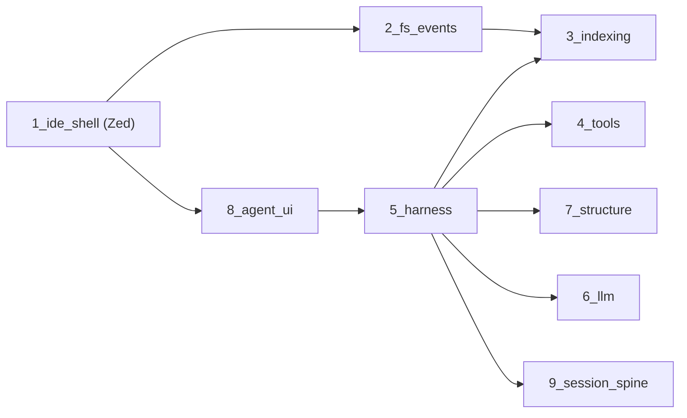

# Totaalproduct — persoonlijke stack

> **Rol:** Hoe alle onderdelen **samenkomen** tot één lokaal solo-product (gedistribueerd als geversioneerde meta-package) dat Cursor op *jouw* workflow moet verslaan — niet op feature-pariteit.
> **Niet hier:** detail per onderdeel (`product/<onderdeel>.md`); open-keuze-werkplannen (`docs/work/specs/onderdeel-*.md`); ADRs.

Per onderdeel bijhouden → het productbestand in de tabel. Werk/beslissen → de gekoppelde spec.

## Waarom dit kan “beter dan Cursor” (voor één gebruiker)

Cursor = VS Code-fork + closed harness + cloud-paden. Overhead zit in Electron, extensie-universum en features die jij niet gebruikt. Jouw voorsprong:

- **Smaller surface** op Arch/Hyprland (native Rust/Zed-basis i.p.v. Electron, geen verplichte zware Docker-containers voor de runtime).
- **Alles lokaal** behalve LLM-API (BYOK), met lichte sandbox-isolatie (`bwrap`) voor untrusted agent-shell/package-commando's.
- **Indexing + structure** op *jouw* repo’s (AE + lab), gebundeld in één eigen, snelle core-executable.
- **Geen** multi-user / SaaS / Cloud Agents, en geen onderhoudslast van een eigen IDE-fork.

Succes = jij productiever en prettiger dan in Cursor (later meetbaar: tokens, turns, keep-rate, friction).

## Gebruikerssituatie (kort)

| Aspect | Jouw case |
|--------|-----------|
| Wie | Solo (Ventje) eerst, daarna vrienden en mensen die me op github volgen of hobyisten. |
| Hosts | Arch Linux + Hyprland — laptop én desktop eerst, daarna kijken naar hoe op MAC OS of Windows |
| Werk | Agent Engineering-standaard + dit lab; veel docs/MD + polyglot later |
| Must | Code **zien** en editen; agent via API; lage RAM/CPU; reproduceerbare installatie via meta-package; sandboxed agent-exec |
| Prefer | Non-Electron (Zed); DeepSeek prijs/kwaliteit of Claude hoogste kwaliteit; indexing zelf sturen; native runtime + `bwrap` sandbox |
| Never | Eigen inference-serving; Electron-shell; IDE zelf forken; zware container-eis voor de IDE/core zelf; feature-bloat “voor anderen” |

## Hoe het samenkomt

| # | Onderdeel | Product (bijhouden) | Spec (open keuzes) | Rol & Distributie in het geheel |
|---|-----------|---------------------|--------------------|---------------------------------|
| 1 | IDE-shell | [ide-shell.md](ide-shell.md) | afgerond — [ADR 0002](../decisions/0002-de-ide-shell-is-upstream-zed-opgehaald-als-pinned-release-zonder-fork.md) | **Gekozen: Zed** (pinned release). Geen fork; native op host; rechtstreeks opgehaald van Zed via meta-package. |
| 2 | FS/events | [fs-events.md](fs-events.md) | [onderdeel-fs-events](../work/specs/onderdeel-fs-events.md) | *Open keuze.* Seam: verse files → indexing (onderdeel van core-executable). |
| 3 | Indexing | [indexing.md](indexing.md) | [onderdeel-indexing](../work/specs/onderdeel-indexing.md) | *Open keuze.* Project-Understanding → agent-tools (eigen module in core-executable). |
| 4 | Tools | [tools.md](tools.md) | [onderdeel-tools](../work/specs/onderdeel-tools.md) | *Open keuze.* Exec: read/edit/shell onder policy & lichte sandbox (`bwrap`/rootless container voor untrusted packages/scripts). |
| 5 | Harness | [harness.md](harness.md) | [onderdeel-harness](../work/specs/onderdeel-harness.md) | *Open keuze.* Loop: orkestreert 3/4/6/7/9 (eigen module in core-executable). |
| 6 | LLM | [llm.md](llm.md) | [onderdeel-llm](../work/specs/onderdeel-llm.md) | *Open keuze.* BYOK-modellen (enige remote pad; via core-executable). |
| 7 | Structure | [structure.md](structure.md) | [onderdeel-structure](../work/specs/onderdeel-structure.md) | *Open keuze.* Standaard afdwingen in de loop (eigen module in core-executable). |
| 8 | Agent-UI | [agent-ui.md](agent-ui.md) | [onderdeel-agent-ui](../work/specs/onderdeel-agent-ui.md) | *Open keuze.* Chat/diffs voor de mens (Zed-extensie of lokale UI). |
| 9 | Session/spine | [session-spine.md](session-spine.md) | [onderdeel-session-spine](../work/specs/onderdeel-session-spine.md) | *Open keuze.* Voortgang over cwd-wissel (eigen module in core-executable). |

**Distributie, Packaging & Isolatie:**
- **Overkoepelende meta-package (Open Source):** Publieke repo met installer en versie-manifest (`lockfile`). Knoopt getest samenwerkende versies aan elkaar en haalt externe software (zoals Zed) rechtstreeks van de officiële bron op (geen forks, transparante licenties).
- **Eigen core-executable (Closed Source binary):** Onderdelen 2 t/m 7 en 9 worden ontwikkeld als losse interne modules/packages, maar voor distributie gecompileerd tot **één enkele native binary** (`agentic-core`) zonder externe runtime-dependencies.
- **Native host vs. Sandboxed exec:** Zed en `agentic-core` draaien **native** op de host voor minimale RAM/CPU-overhead. Alleen untrusted agent-acties (zoals `shell`-commando's en het installeren van publieke packages als `npm`/`pip` binnen een project) worden via `4_tools` geïsoleerd in een lichte sandbox (`bwrap` op Arch) met enkel toegang tot de workspace.

**Dataflow (één zin):** jij werkt in Zed (IDE-shell) → FS/events houdt indexing fris → harness (in de core-executable) vraagt indexing + tools (sandboxed waar nodig), praat met LLM, dwingt structure af, schrijft spine → Agent-UI toont diffs/chat.

**Kern vs host:** waarde = indexing + harness + structure (jouw eigen closed-source core). IDE-shell (Zed), Agent-UI en FS/events zijn nodig maar geen feature-race met Cursor.

**Niet in v1:** obs-dashboard, Cloud Agents, multi-user, inference-serving, extensie-marktplaats, eigen Zed-fork onderhouden, zware container-runtime voor de IDE zelf.

Parent-plan: [totaalproduct-onderdelen](../work/specs/totaalproduct-onderdelen.md). A4-shortlist IDE: [cursor-vervang-lagen](../work/specs/cursor-vervang-lagen.md).

## Volgorde van beslissen (geen code tot ADR)

Canonieke stappenlijst + status: [BACKLOG.md § Volgorde](../work/BACKLOG.md#volgorde-totaalproduct).

0. Kader ([totaalproduct-onderdelen](../work/specs/totaalproduct-onderdelen.md)) → 1. [ide-shell](ide-shell.md) *(Zed gekozen)* → 2. [indexing](indexing.md) → 3. [fs-events](fs-events.md) → 4. [harness](harness.md) → 5. [tools](tools.md) → 6. [llm](llm.md) → 7. [structure](structure.md) → 8. [session-spine](session-spine.md) → 9. [agent-ui](agent-ui.md).