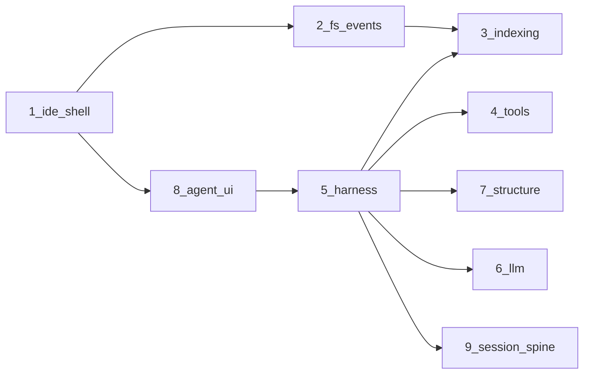

# Totaalproduct — persoonlijke stack

> **Rol:** Hoe alle onderdelen **samenkomen** tot één lokaal solo-product dat Cursor op *jouw* workflow moet verslaan — niet op feature-pariteit.
> **Niet hier:** detail per onderdeel (`product/<onderdeel>.md`); open-keuze-werkplannen (`docs/work/specs/onderdeel-*.md`); ADRs.

Per onderdeel bijhouden → het productbestand in de tabel. Werk/beslissen → de gekoppelde spec.

## Waarom dit kan “beter dan Cursor” (voor één gebruiker)

Cursor = VS Code-fork + closed harness + cloud-paden. Overhead zit in Electron, extensie-universum en features die jij niet gebruikt. Jouw voorsprong:

- **Smaller surface** op Arch/Hyprland.
- **Alles lokaal** behalve LLM-API (BYOK).
- **Indexing + structure** op *jouw* repo’s (AE + lab).
- **Geen** multi-user / SaaS / Cloud Agents.

Succes = jij productiever en prettiger dan in Cursor (later meetbaar: tokens, turns, keep-rate, friction).

## Gebruikerssituatie (kort)

| Aspect | Jouw case |
|--------|-----------|
| Wie | Solo (Ventje); niemand anders hoeft het te draaien |
| Hosts | Arch Linux + Hyprland — laptop én desktop |
| Werk | Agent Engineering-standaard + dit lab; veel docs/MD + polyglot later |
| Must | Code **zien** en editen; agent via API; lage RAM/CPU |
| Prefer | Non-Electron; DeepSeek prijs/kwaliteit; indexing zelf sturen |
| Never | Eigen inference-serving; Electron-shell; feature-bloat “voor anderen” |

## Hoe het samenkomt

| # | Onderdeel | Product (bijhouden) | Spec (open keuzes) | Rol in het geheel |
|---|-----------|---------------------|--------------------|-------------------|
| 1 | IDE-shell | [ide-shell.md](ide-shell.md) | [onderdeel-ide-shell](../work/specs/onderdeel-ide-shell.md) | Host: zien/editen; hangpunt voor UI + events |
| 2 | FS/events | [fs-events.md](fs-events.md) | [onderdeel-fs-events](../work/specs/onderdeel-fs-events.md) | Seam: verse files → indexing |
| 3 | Indexing | [indexing.md](indexing.md) | [onderdeel-indexing](../work/specs/onderdeel-indexing.md) | Project-Understanding → agent-tools |
| 4 | Tools | [tools.md](tools.md) | [onderdeel-tools](../work/specs/onderdeel-tools.md) | Exec: read/edit/shell onder policy |
| 5 | Harness | [harness.md](harness.md) | [onderdeel-harness](../work/specs/onderdeel-harness.md) | Loop: orkestreert 3/4/6/7/9 |
| 6 | LLM | [llm.md](llm.md) | [onderdeel-llm](../work/specs/onderdeel-llm.md) | BYOK-modellen (enige remote pad) |
| 7 | Structure | [structure.md](structure.md) | [onderdeel-structure](../work/specs/onderdeel-structure.md) | Standaard afdwingen in de loop |
| 8 | Agent-UI | [agent-ui.md](agent-ui.md) | [onderdeel-agent-ui](../work/specs/onderdeel-agent-ui.md) | Chat/diffs voor de mens |
| 9 | Session/spine | [session-spine.md](session-spine.md) | [onderdeel-session-spine](../work/specs/onderdeel-session-spine.md) | Voortgang over cwd-wissel |

**Dataflow (één zin):** jij werkt in de IDE-shell → FS/events houdt indexing fris → harness vraagt indexing + tools, praat met LLM, dwingt structure af, schrijft spine → Agent-UI toont diffs/chat.

**Kern vs host:** waarde = indexing + harness + structure. IDE-shell, Agent-UI en FS/events zijn nodig maar geen feature-race met Cursor.

**Niet in v1:** obs-dashboard, Cloud Agents, multi-user, inference-serving, extensie-marktplaats.

Parent-plan: [totaalproduct-onderdelen](../work/specs/totaalproduct-onderdelen.md). A4-shortlist IDE: [cursor-vervang-lagen](../work/specs/cursor-vervang-lagen.md).

## Volgorde van beslissen (geen code tot ADR)

1. Use-case hier + in [indexing.md](indexing.md) scherp houden.  
2. [ide-shell.md](ide-shell.md) A4-score.  
3. [indexing.md](indexing.md) compose + [fs-events.md](fs-events.md) contract.  
4. [harness.md](harness.md) (DSH-neiging) + [tools.md](tools.md).  
5. [llm.md](llm.md) default ADR.  
6. [structure.md](structure.md) + [session-spine.md](session-spine.md) (A6–A9 → ADR).  
7. [agent-ui.md](agent-ui.md) minimaal.
