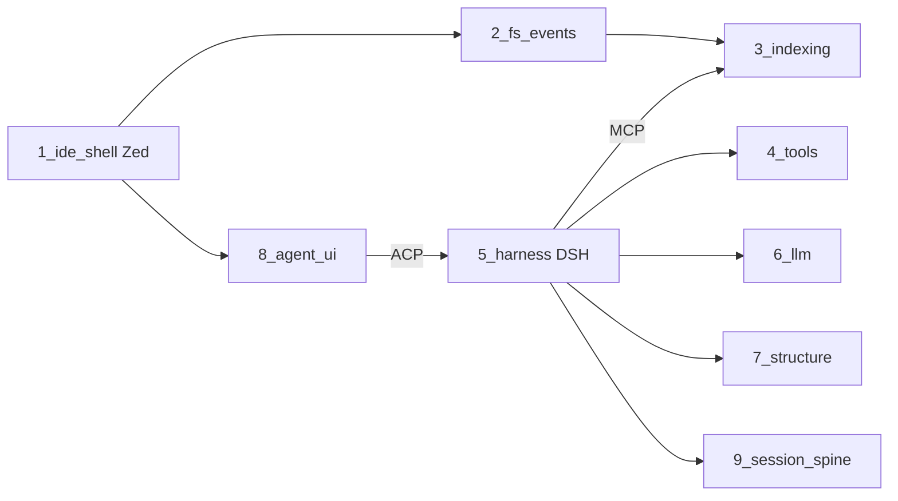

# Totaalproduct — persoonlijke stack

> **Rol:** Hoe alle onderdelen **samenkomen** tot één lokaal solo-product (gedistribueerd als geversioneerde meta-package) dat Cursor op *jouw* workflow moet verslaan — niet op feature-pariteit.
> **Niet hier:** detail per onderdeel (`product/<onderdeel>.md`); open-keuze-werkplannen (`docs/work/specs/onderdeel-*.md`); ADRs.

Per onderdeel bijhouden → het productbestand in de tabel. Werk/beslissen → de gekoppelde spec.

## Waarom dit kan “beter dan Cursor” (voor één gebruiker)

Cursor = VS Code-fork + closed harness + cloud-paden. Overhead zit in Electron, extensie-universum en features die jij niet gebruikt. Jouw voorsprong:

- **Smaller surface** op Arch/Hyprland (upstream Zed i.p.v. Electron, geen verplichte zware Docker-containers voor de runtime).
- **Alles lokaal** behalve LLM-API (BYOK via de geïmporteerde harness), met lichte sandbox-isolatie (`bwrap`) voor untrusted agent-shell/package-commando's.
- **Indexing + structure** op *jouw* repo’s (AE + lab). De agent-loop importeer je (DeepSeek Harness); die bouw je niet na.
- **Geen** multi-user / SaaS / Cloud Agents, en geen onderhoudslast van een eigen IDE-fork of harness-fork.

Succes = jij productiever en prettiger dan in Cursor (later meetbaar: tokens, turns, keep-rate, friction). Dat is geen feature-race met Zed.

## Segment

| | Cursor | Zed | Jij |
|---|--------|-----|-----|
| Voor wie | Pro-devs en teams, cloud-paden | Snelle lokale IDE, brede groep | Eén gebruiker eerst (later hobbyisten), Arch, eigen repo’s |
| Wat ze meeslepen | Electron, cloud-index, marketplace, multi-agent cloud | Collaboratie, eigen Zed Agent, grep-tools in dezelfde binary | Niets daarvan bouwen |
| Waar jij korter zit | — | — | Index + structure op AE + lab; één agent-proces; DeepSeek via BYOK |

Multi-user of collaboratie uit de Zed-binary halen zodat de editor sneller wordt, lukt niet zonder fork. Ongebruikte Zed-code blijft in het pakket dat de meta-package downloadt. De winst is die paden **niet starten**: geen Zed Agent, geen tweede index, geen Electron. Korter op de bal = minder product dat jij onderhoudt, niet een gestripte Zed.

## Een laag vervangen zonder fork

Zed blijft de host. De agent-loop is een tweede upstream-proces. Jouw index hangt daaraan als MCP. Zed’s eigen zoek- en agentcode blijft in de binary en draait niet op jouw pad zolang je alleen de External Agent gebruikt.

- Indexing van Zed verdwijnt niet uit Zed. Hij draait niet mee als Zed Agent uit staat.
- Jouw index is een apart proces. Geen dubbele index tenzij je beide agents gebruikt.
- Onderhoud: Zed-updates en DSH-updates blijven upstream. Jij onderhoudt de verbinding (ACP-start + MCP-contract) en de index.

Of antwoorden beter zijn dan Zed Agent is nog geen meting. De hypothese: beter voor dit segment als de loop upstream DeepSeek-getuned blijft, jouw index de grep-ronde vervangt, en Zed Agent uit blijft. Risico: DSH is preview en kan breaking wijzigen. Meten = later één smoke (zelfde taak, Zed Agent vs `dsh --profile acp`).

## Gebruikerssituatie (kort)

| Aspect | Jouw case |
|--------|-----------|
| Wie | Solo (Ventje) eerst, daarna vrienden en mensen die me op github volgen of hobyisten. |
| Hosts | Arch Linux + Hyprland — laptop én desktop eerst, daarna kijken naar hoe op MAC OS of Windows |
| Werk | Agent Engineering-standaard + dit lab; veel docs/MD + polyglot later |
| Must | Code **zien** en editen; agent via API; lage RAM/CPU; reproduceerbare installatie via meta-package; sandboxed agent-exec |
| Prefer | Non-Electron (Zed); DeepSeek prijs/kwaliteit of Claude hoogste kwaliteit; indexing zelf sturen; native runtime + `bwrap` sandbox |
| Never | Eigen inference-serving; Electron-shell; IDE of harness zelf forken; zware container-eis voor de IDE zelf; feature-bloat “voor anderen” |

## Hoe het samenkomt

| # | Onderdeel | Groep | Product | Spec | Rol |
|---|-----------|-------|---------|------|-----|
| 1 | IDE-shell | Host Zed · af | [ide-shell.md](ide-shell.md) | afgerond — [ADR 0002](../decisions/0002-de-ide-shell-is-upstream-zed-opgehaald-als-pinned-release-zonder-fork.md) | Pinned upstream. Geen fork. |
| 2 | FS/events | Host Zed · af | [fs-events.md](fs-events.md) | afgerond — geen ADR | Zed houdt de enige OS-watch. Index vers via git-anker + vuile paden. |
| 8 | Agent-UI | Host Zed · af | [agent-ui.md](agent-ui.md) | afgerond — [onderdeel-agent-ui](../work/specs/onderdeel-agent-ui.md) | Zed Agent Panel via ACP. Geen eigen chat-UI. |
| 5 | Harness | Import · beslist | [harness.md](harness.md) | [ADR 0003](../decisions/0003-de-agent-loop-is-upstream-deepseek-harness-gepind-als-dsh-profile-acp-zonder-fork.md) | DeepSeek Harness, `dsh --profile acp`, geen fork. |
| 4 | Tools | Volgt import | [tools.md](tools.md) | [onderdeel-tools](../work/specs/onderdeel-tools.md) | Toolset van DSH + indexing-MCP, beslist in ADR 0003. Sandbox (T3) open. |
| 6 | LLM | Volgt import | [llm.md](llm.md) | [onderdeel-llm](../work/specs/onderdeel-llm.md) | Model en keys horen bij DSH. Default DeepSeek (ADR 0003). |
| 3 | Indexing | Onderzoek | [indexing.md](indexing.md) | [onderdeel-indexing](../work/specs/onderdeel-indexing.md) | Compose (Zoekt/SCIP). MCP die DSH mount. Vervangt zoeken op het agent-pad, niet de editor. |
| 7 | Structure | Ontwerp op harness | [structure.md](structure.md) | [onderdeel-structure](../work/specs/onderdeel-structure.md) | `make check` / hooks bovenop DSH. Geen tweede prose-laag naast Zed Instructions. |
| 9 | Session/spine | Ontwerp op harness | [session-spine.md](session-spine.md) | [onderdeel-session-spine](../work/specs/onderdeel-session-spine.md) | `.agent/` blijft SoR over cwd-wissel. DSH-sessions blijven bestaan. |

**Distributie:**

- **Meta-package:** installer + versie-manifest. Haalt Zed en DeepSeek Harness rechtstreeks van upstream (geen forks).
- **Eigen werk:** de index als apart proces, plus later de structure-haak en de spine. Niet de IDE, niet de agent-loop.
- **Isolatie:** Zed en `dsh` draaien als upstream-processen. Untrusted shell en package-install (`npm` / `pip`) lopen onder `bwrap` met alleen de workspace — afspraak staat in [tools.md](tools.md), nog niet als ADR.

**Dataflow (één zin):** jij werkt in Zed → het Agent Panel praat ACP met DSH → DSH gebruikt zijn tools en LLM, bevraagt jouw index via MCP, en (later) structure + spine → diffs zie je in Zed.

**Kern vs host:** waarde = indexing + structure. Host = Zed (shell, watch, panel). Loop = geïmporteerde DSH. Zed Agent en zijn grep blijven in de binary en horen uit te staan op dit pad.

**Niet in v1:** obs-dashboard, Cloud Agents, multi-user, inference-serving, extensie-marktplaats, eigen Zed- of DSH-fork, zware container-runtime voor de IDE zelf, een tweede chat-UI.

Parent-plan: [totaalproduct-onderdelen](../work/specs/totaalproduct-onderdelen.md). A4-shortlist IDE: [cursor-vervang-lagen](../work/specs/cursor-vervang-lagen.md).

## Volgorde van beslissen (geen code tot ADR)

Canonieke stappenlijst + status: [BACKLOG.md § Volgorde](../work/BACKLOG.md#volgorde-totaalproduct).

0. Kader ([totaalproduct-onderdelen](../work/specs/totaalproduct-onderdelen.md)) → 1. [ide-shell](ide-shell.md) *(Zed)* → 2. [fs-events](fs-events.md) *(Zed)* → 3. [agent-ui](agent-ui.md) *(Zed-panel via ACP)* → 4. [harness](harness.md) *([ADR 0003](../decisions/0003-de-agent-loop-is-upstream-deepseek-harness-gepind-als-dsh-profile-acp-zonder-fork.md))* → 5. [llm](llm.md) + [tools](tools.md) *(default en whitelist mee; T3 open)* → 6. [indexing](indexing.md) *(onderzoek; MCP naar DSH)* → 7. [structure](structure.md) → 8. [session-spine](session-spine.md).
