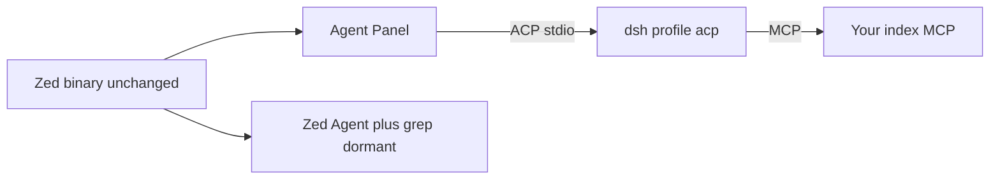
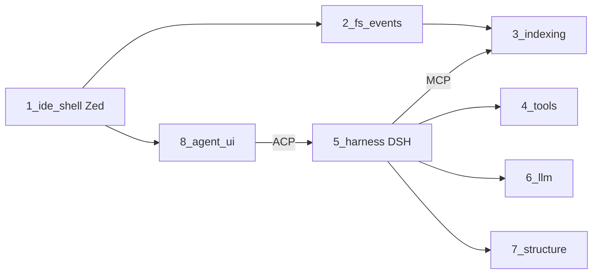

# Whole product — personal stack

> **Role:** how the parts of the **lab path** come together: Zed + DeepSeek Harness with an API key, plus indexing and the structure from `kit/`. That stack on Arch Linux Hyprland is the next completion ([ADR 0012](../decisions/0012-the-next-completion-is-the-personal-stack-on-arch-linux-hyprland.md)). It is one package from [ADR 0010](../decisions/0010-the-meta-package-points-to-separate-packages-for-structure-and-three-zed-paths.md), not the whole product.
> **Not here:** what someone takes away ([PRODUCT.md](PRODUCT.md)); per-part detail (`product/<part>.md`); ADRs.

Per part follow-up → the product file in the table. Work/decision → the linked spec.

## Why this can be "better than Cursor" (for one user)

Cursor = a VS Code fork + closed harness + cloud paths. The overhead lives in Electron, the extension universe and features you do not use. Your advantage:

- **Smaller surface** on Arch/Hyprland (upstream Zed instead of Electron, no mandatory heavy Docker containers for the runtime).
- **Everything local** except the LLM API (BYOK through the imported harness), with light sandbox isolation (`bwrap`) for untrusted agent shell/package commands.
- **Indexing + structure** over *your* repos. You import the agent loop (DeepSeek Harness); you do not rebuild it.
- **No** multi-user / SaaS / Cloud Agents, and no maintenance burden of an own IDE fork or harness fork.

Success = you more productive and more comfortable than in Cursor (later measurable: tokens, turns, keep rate, friction). That is not a feature race with Zed.

## Segment

| | Cursor | Zed | You |
|---|--------|-----|-----|
| For whom | Pro devs and teams, cloud paths | Fast local IDE, broad group | One user first (hobbyists later), Arch, own repos |
| What they drag along | Electron, cloud index, marketplace, multi-agent cloud | Collaboration, its own Zed Agent, grep tools in the same binary | Build none of that |
| Where you are leaner | — | — | Index + structure over your repos; one agent process; DeepSeek via BYOK |

Removing multi-user or collaboration from the Zed binary to make the editor faster does not work without a fork. Unused Zed code stays in the package the meta package downloads. The gain is **not starting** those paths: no Zed Agent, no second index, no Electron. Leaner means less product you maintain, not a stripped-down Zed.

## Replacing a layer without a fork

Zed stays the host. The agent loop is a second upstream process. Your index hangs off it as MCP. Zed's own search and agent code stays in the binary and does not run on your path as long as you only use the External Agent.

- Zed's indexing does not disappear from Zed. It does not run while Zed Agent is off.
- Your index is a separate process. No double index unless you use both agents.
- Maintenance: Zed updates and DSH updates stay upstream. You maintain the connection (ACP start + MCP contract) and the index.

Whether answers are better than Zed Agent is not yet measured. The hypothesis: better for this segment if the loop stays upstream DeepSeek-tuned, your index replaces the grep round, and Zed Agent stays off. Risk: DSH is preview and may change in breaking ways. Measuring = later one smoke test (same task, Zed Agent vs `dsh --profile acp`).

## User situation (brief)

| Aspect | Your case |
|--------|-----------|
| Who | Solo (Ventje) first, then friends and people who follow me on GitHub or hobbyists. |
| Hosts | Arch Linux + Hyprland — laptop and desktop first, then look at macOS or Windows |
| Work | The agent-engineering standard + this lab; lots of docs/MD + polyglot later |
| Must | **See** and edit code; agent via API; low RAM/CPU; reproducible install via the meta package; sandboxed agent exec |
| Prefer | Non-Electron (Zed); DeepSeek price/quality or Claude for highest quality; steer indexing yourself; native runtime + `bwrap` sandbox |
| Never | Own inference serving; Electron shell; forking the IDE or harness; a heavy container requirement for the IDE itself; feature bloat "for others" |

## How it comes together

| # | Part | Group | Product | Spec | Role |
|---|------|-------|---------|------|------|
| 1 | IDE shell | Host Zed · done | [ide-shell.md](ide-shell.md) | done — [ADR 0002](../decisions/0002-the-ide-shell-is-upstream-zed-pulled-as-a-pinned-release-without-fork.md) | Pinned upstream. No fork. |
| 2 | FS/events | Host Zed · done | [fs-events.md](fs-events.md) | done — no ADR | Zed holds the only OS watch. Index fresh via git anchor + dirty paths. |
| 8 | Agent UI | Host Zed · done | [agent-ui.md](agent-ui.md) | done — the product doc suffices | Zed Agent Panel via ACP. No own chat UI. |
| 5 | Harness | Import · decided | [harness.md](harness.md) | [ADR 0003](../decisions/0003-the-agent-loop-is-upstream-deepseek-harness-pinned-as-a-dsh-profile-acp-without-fork.md) | DeepSeek Harness, `dsh --profile acp`, no fork. |
| 4 | Tools | Follows import · decided | [tools.md](tools.md) | [ADR 0007](../decisions/0007-tool-approval-is-a-workspace-allowlist-and-the-shell-runs-under-bwrap.md) | Workspace allowlist. Shell and `npm`/`pip` under `bwrap`. |
| 6 | LLM | Follows import · decided | [llm.md](llm.md) | [ADR 0008](../decisions/0008-the-coding-model-is-deepseek-flash-and-claude-is-the-second-provider.md) | `deepseek-flash`. Claude is the second provider. |
| 3 | Indexing | decided | [indexing.md](indexing.md) | [ADR 0006](../decisions/0006-the-agent-searches-via-jarvis-as-mcp-zed-search-and-lsp-stay-with-the-editor.md) | jarvis via MCP. Agent path only. Editor search and LSP stay with Zed. |
| 7 | Structure | Design on harness · decided | [structure.md](structure.md) | [ADR 0004](../decisions/0004-the-project-standard-is-dual-a-thin-agents-md-and-a-hard-make-check.md) | A thin `AGENTS.md` plus `make check` on DSH. No second prose layer beside Zed Instructions. |
| 9 | Session/spine | skipped | [session-spine.md](session-spine.md) | [ADR 0005](../decisions/0005-the-conversation-remains-the-zed-and-dsh-session-without-repo-spine.md) | No repo spine. The conversation = Zed panel + DSH session. |

**Distribution of this path:**

- **Package "Zed + DeepSeek Harness":** installer + version manifest. Pulls Zed and DeepSeek Harness straight from upstream (no forks). The other packages are in [ADR 0010](../decisions/0010-the-meta-package-points-to-separate-packages-for-structure-and-three-zed-paths.md).
- **Your own work:** the index as a separate process, plus later the structure hook. Not the IDE, not the agent loop, no repo spine.
- **Isolation:** Zed and `dsh` run as upstream processes. Shell and package install (`npm` / `pip`) run under `bwrap` with only the workspace ([ADR 0007](../decisions/0007-tool-approval-is-a-workspace-allowlist-and-the-shell-runs-under-bwrap.md)).

**Dataflow (one sentence):** you work in Zed → the Agent Panel talks ACP to DSH → DSH uses its tools and LLM, queries your index via MCP, and (later) structure → you see the diffs in Zed. The conversation stays that DSH session.

**Core vs host:** value = indexing + structure. Host = Zed (shell, watch, panel). Loop = imported DSH. Zed Agent and its grep stay in the binary and should be off on this path.

**Not in v1:** obs dashboard, Cloud Agents, multi-user, inference serving, extension marketplace, an own Zed or DSH fork, a heavy container runtime for the IDE itself, a second chat UI, a repo spine.

The A4 shortlist for the IDE and the parent plan: gone — decisions in [ADR 0002](../decisions/0002-the-ide-shell-is-upstream-zed-pulled-as-a-pinned-release-without-fork.md) and the product docs.

## Order of deciding (no code before an ADR)

Canonical step list + status: [BACKLOG.md § Order](../work/BACKLOG.md#order-whole-product).

1. [ide-shell](ide-shell.md) *(Zed)* → 2. [fs-events](fs-events.md) *(Zed)* → 3. [agent-ui](agent-ui.md) *(Zed panel via ACP)* → 4. [harness](harness.md) *([ADR 0003](../decisions/0003-the-agent-loop-is-upstream-deepseek-harness-pinned-as-a-dsh-profile-acp-without-fork.md))* → 5. [llm](llm.md) + [tools](tools.md) *(allowlist in 0003; allowlist and `bwrap` in [0007](../decisions/0007-tool-approval-is-a-workspace-allowlist-and-the-shell-runs-under-bwrap.md); `deepseek-flash` and Claude in [0008](../decisions/0008-the-coding-model-is-deepseek-flash-and-claude-is-the-second-provider.md))* → 6. [indexing](indexing.md) *([ADR 0006](../decisions/0006-the-agent-searches-via-jarvis-as-mcp-zed-search-and-lsp-stay-with-the-editor.md); agent path only)* → 7. [structure](structure.md) *([ADR 0004](../decisions/0004-the-project-standard-is-dual-a-thin-agents-md-and-a-hard-make-check.md))* → 8. [session-spine](session-spine.md) *(skipped, [ADR 0005](../decisions/0005-the-conversation-remains-the-zed-and-dsh-session-without-repo-spine.md))*.
