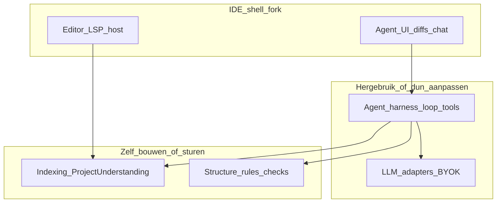

# Spec — cursor-vervang-lagen

> **Rol:** Plan voor één werkitem. Tijdelijk: na merge verwijderen; de code en de tests zijn dan de waarheid.

- **Item:** [BACKLOG.md](../BACKLOG.md) · branch `docs/cursor-vervang-lagen`
- **Status:** gedaan (2026-11-07) — componentkaart SoR → [totaalproduct.md](../../product/totaalproduct.md); A4-shortlist hier behouden

## Doel

Vastleggen welke lagen nodig zijn om Cursor te vervangen (lichte non-Electron IDE + eigen indexing/project-understanding + herbruikbare harness + BYOK-modellen), plus een A4-shortlist van fork-kandidaten voor Arch/Hyprland — zodat B-ADRs op een kaart rusten i.p.v. chat.

## Scope

- **In:** Componentkaart; seam waar Project-Understanding zit (`indexing`); A4-criteria + shortlist (geen Electron); onderzoeksslices A4→A5→B; hypothese-update in `ideeen` / programma (geen ADR).
- **Buiten scope:** IDE vanaf nul bouwen; Electron-forks; inference-serving (DeepInfer e.d.); bachelorproef-outline; stack/ADR/runtime-keuze; code in `apps/`; feature-pariteit met Cursor Cloud/Composer.

## Raakvlakken

- Modules en bestanden: `docs/research/ideeen-en-vragen.md`, `docs/research/onderzoek-programma.md`, `docs/research/wantlist.md`, later `docs/research/vergelijking-harness-ide.md`
- Domeinen: `harness` · `structure` · `indexing` ([GLOSSARY.md](../../context/GLOSSARY.md))
- Seams die raken: IDE↔indexing, harness↔indexing, harness↔LLM, structure↔checks ([ARCHITECTURE.md](../../architecture/ARCHITECTURE.md))
- Voorbeeld: [onderzoek-a2-harnesses.md](onderzoek-a2-harnesses.md)

## Componentkaart (Cursor vervangen)

| # | Laag | Rol | Cursor-equivalent | Lab-richting |
|---|------|-----|-------------------|--------------|
| 1 | **IDE-shell** | Buffers, tree, terminal, keybindings, LSP/DAP-host | Electron-app | **Fork** extreem lichte native/TUI IDE — geen Electron, geen from-scratch |
| 2 | **Agent-UI** | Chat, apply/reject, inline diff | Composer/chat | Dunne UI in de fork of plugin; niet het onderzoekscentrum |
| 3 | **Harness** | Agent-loop, tools, permissions, sessions, model-routing | Cursor agent runtime | **Hergebruik** (Pi-/DSH-achtig oppervlak); geen DeepInfer |
| 4 | **Structure** | Rules, `AGENTS`, hooks, `make check` | `.cursorrules` / always-on prose | Dual (docs + enforcement) — al **vorm** A6/A7 |
| 5 | **Indexing / Project-Understanding** | Snelle codebase-discovery + retrieval als tools | Instant Grep, index, `@codebase` | **Primair eigen werk** — exact/regex-first (§69); semantic later meten |
| 6 | **LLM-adapters** | BYOK DeepSeek / Claude / … | Model picker | Config + `.env`; DeepSeek-richting cost; geen vendor-lock zonder ADR |
| 7 | **Exec / sandbox** | Shell, edits, MCP | Tool runner | Via harness; permissions strict |
| 8 | **Session / spine** | State over cwd-/workspace-wissel | Chat-history | Folder-spine `.agent/` — **vorm** A9 |
| 9 | **Obs / meten** | Tokens, keep-rate, tool-errors | Interne Cursor-metrics | Lab later; H×M altijd noemen |

### Waar zit Project-Understanding?

**Domein `indexing`**, niet “de IDE” en niet “de hele harness”.

- IDE levert: FS-events, open buffers, selectie, workspace-root.
- Indexing levert: snelle search/map/retrieval (tools of queries).
- Harness consumeert: indexed context in de loop; structure dwingt regels af.

Thesis-diepte hoort **niet** in deze spec (andere chat). Hier alleen: indexing is de **primaire** bouw-/onderzoeksfocus van het lab-pad.

### Wat we bewust niet zelf doen

- Inference-serving / GPU-runtime (DeepInfer e.d.).
- Volledige IDE-engine (renderer, LSP-host, …) vanaf nul.
- Electron-stack (VS Code / VSCodium / PearAI-achtig) — te zwaar voor Arch/Hyprland-doel.

## A4-shortlist — criteria (vóór fork-ADR)

Score per kandidaat (later in A4-§ / matrix): **must** = afwijzen als nee.

| Criterium | Must / nice | Toelichting |
|-----------|-------------|-------------|
| Geen Electron / Chromium-shell | **Must** | Weinig overhead op laptop + desktop |
| Native of TUI (Rust/Zig/C++/… of Helix/Neovim-klasse) | **Must** | Snelle start, lage RAM |
| OSI-vriendelijke fork-licentie | **Must** | Eigen uitbreidingen legaal |
| Actief genoeg (commits / maintainers) | **Must** | Geen dode fork-basis |
| Aanhaken harness (RPC/plugin/extension/ACP) | **Must** | Anders blijf je Cursor-host |
| Haakpunten voor indexing (workspace API, FS-watch, tool-bridge) | **Must** | Primair lab-doel |
| “Extreem licht” codebase / runtime | Nice | Makkelijker forken dan Zed-monoliet |
| Git/diff UI out-of-the-box | Nice | Anders later dun toevoegen |
| Arch/Hyprland (Wayland) stabiel | Nice | Jouw hosts |

### Kandidaten om in A4 te scoren (geen keuze nu)

| Kandidaat | Klasse | Waarom op de lijst | Risico |
|-----------|--------|--------------------|--------|
| **Zed** | Native Rust IDE | Modern, GPU, agent-richting in ecosysteem | Grote boom; fork-zwaar |
| **Lapce** | Native Rust IDE | Lichter dan Electron; IDE-vorm | Rijpheid / momentum |
| **Helix** | Rust modal editor | Extreem licht; LSP | Weinig “IDE”; harness-UI zelf bouwen |
| **Neovim** (+ dunne GUI of terminal) | Editor + plugins | Minimale overhead; Lua-bridge | Geen fork-IDE; eerder host |
| **Kate** (KTextEditor) | Qt native | Echte IDE-lichte shell | Qt-gewicht; agent-ecosysteem dun |

**Afgewezen voor shortlist (must-fail):** VS Code / VSCodium / Code-OSS / PearAI / andere Electron-AI-IDEs.

**Fork vs koppelen (beslisregel voor A4-eind):**

1. Heeft de basis plugin/RPC om harness + indexing *buiten* de core te houden → **koppel eerst**, fork alleen voor must-have shell-gaten.
2. Ontbreekt die surface structureel → **fork** van de lichtste kandidaat die wél LSP + workspace-hooks heeft.
3. Nooit: eigen editor-renderer bouwen zolang een shortlist-kandidaat voldoet.

## Hypothese B (lab v1 — nog geen ADR)

> Lichte **non-Electron** IDE-shell (fork of dunne koppeling na A4-score) + **eigen indexing** (exact-first) + **hergebruikte harness** (Pi-/DSH-achtig) + BYOK-LLM. Structure/spine volgens A6–A9-vorm. Geen inference-serving. Geen Cursor-feature-pariteit.

## Slices (elk apart testbaar, één sessie)

1. **Kaart vast** — deze spec + hypothese in [ideeen-en-vragen.md](../../research/ideeen-en-vragen.md) (A4 + B) en korte pointer in [onderzoek-programma.md](../../research/onderzoek-programma.md); BACKLOG-categorie + Straks-regel.
2. **A4-bronnen** — per shortlist-kandidaat: architecture / license / extension-surface → § in AE `bron/` (+ wantlist-status); Electron-afwijzing expliciet.
3. **A4-scorematrix** — tabel criteria×kandidaat in `vergelijking-harness-ide.md` (of A4-sectie); eindigen met fork-vs-koppel advies (nog geen ADR).
4. **Seam-contract (papier)** — indexing tool-API schets (inputs van IDE, outputs naar harness); geen code. Voedt later `product/indexing.md`.
5. **Poort naar B** — na A5-matrix + mens-ja: ADR-kandidaten (IDE-basis, harness-basis, indexing v1, LLM-default).

## Acceptatie

- [x] Spec bevat volledige componentkaart + Project-Understanding = `indexing`
- [x] A4-criteria + shortlist zonder Electron; DeepInfer buiten scope
- [x] `ideeen` A4/B en programma-hypothese wijzen naar “lichte IDE + eigen indexing + hergebruik harness”
- [x] BACKLOG Nu-regel categorie `research`; Straks A4 wijst naar deze spec
- [x] Geen stack/ADR/apps-code in slice 1
- [ ] Slice 2–5 (A4-bronnen, scorematrix, seam-papier, poort B) — nog open
- [x] `make links` groen; `make check` rood zonder app (bekend, geen stack)
