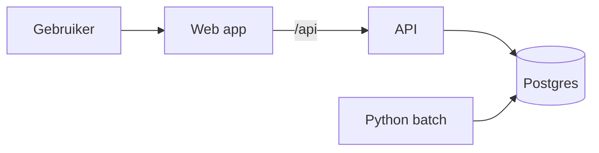

# Architectuur

> **Rol:** Hoe het systeem in elkaar zit op containerniveau. Diepte per subsysteem: zie de links onderaan.
> **Niet hier:** mappenboom (`ls`), codedetails (de code), het waarom (`decisions/`), PWA/offline/push/chrome-poll, auth-flows en feature-catalogus — die horen in `architecture/<subsysteem>.md` (bv. `runtime-client.md`, `auth.md`).

## Systeemcontext

<Eén alinea: wie het gebruikt, wat het systeem doet, met welke externe systemen het praat.>

## Containers

| Container | Pad | Taak | Poort lokaal | Host in productie |
|-----------|-----|------|--------------|-------------------|
| <web> | `apps/web` | <…> | <:3000> | <domein> |

## Stack

| Laag | Keuze | Waarom (ADR) |
|------|-------|--------------|
| <Frontend> | <Next.js> | <0002> |

Extra taal / native hot path (Rust, C, …): niet in deze tabel zetten zonder ADR. Beslisboom en grenzen: [polyglot.md](polyglot.md). Voorbeeld-ADR: [0000-voorbeeld-native-module-na-budget-breuk.md](../decisions/0000-voorbeeld-native-module-na-budget-breuk.md). Native-mappen bestaan alleen met die stack — zie polyglot.

## Dataflow en eigenaarschap

- <Wie schrijft waar: "Postgres is de enige writer van user-data; de batch leest alleen.">
- <Waar data vandaan komt en heen gaat; de lagen in `data/` staan in [data/README.md](../../data/README.md).>

## Hosting en poorten

- <Waar elke container draait, welke domeinen, hoe er gedeployd wordt.>

## Wat in git staat

- <Alleen wat afwijkt van de standaard, bv. "`data/processed/demo/` staat in git en wordt door de web-app gelezen".>

## Invarianten

- <Wat altijd waar moet zijn, met een link naar de ADR of test die het bewaakt.>

## Seams (naden)

Waar containers of modules op elkaar aansluiten. Hier horen de integratietests; hier mag AI veilig raken zodra die tests bestaan.

| Seam | Wat erover gaat | Bewaakt door |
|------|-----------------|--------------|
| <web → api> | <HTTP-contract / gedeelde types> | <integratietest of contracttest> |
| <api → db> | <wie schrijft welke tabellen> | <migratie + repository-test> |

- **Mag een agent zonder akkoord:** code *binnen* een bestaande domeinmodule, achter een stabiele interface.
- **Eerst vragen of ADR:** nieuwe map/module, nieuwe writer, gedeelde `utils/`, of een seam die verplaatst.

## Subsystemen

- [polyglot.md](polyglot.md) — Wanneer native/extra taal mag; FFI vs sidecar; wat de agent mag.
- [security.md](security.md) — Secrets, auth-principes, Strix; detail-flows → `auth.md` of data-model.
- [observability.md](observability.md) · [performance.md](performance.md) · [dependencies.md](dependencies.md) — alleen bij die opdracht (via INDEX).
- [<subsysteem>.md](<subsysteem>.md) — <één zin; bv. runtime-client, auth, data-model, engine>
