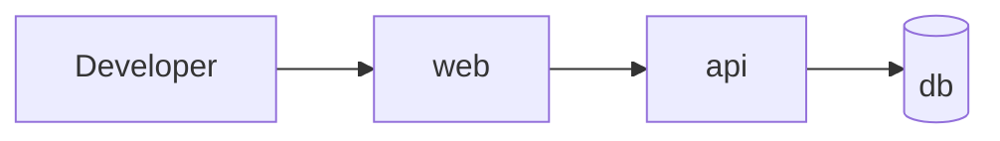

# Architecture

> **Role:** how the system fits together at container level. Depth per subsystem: see the links at the bottom.
> **Not here:** the directory tree (`ls`), code details (the code), the why (`decisions/`), PWA/offline/push/chrome-poll, auth flows and the feature catalogue — those belong in `architecture/<subsystem>.md` (e.g. `runtime-client.md`, `auth.md`).

## System context

<One paragraph: what the system is, who uses it, and which external systems it talks to.> No prod hosting yet.

## Containers

No app stack yet. After the runtime choice, replace this with the real containers:

| Container | Path | Task | Port locally | Host in production |
|-----------|------|------|--------------|--------------------|
| web | `apps/web` | <task> | <port> | <host> |
| api | `apps/api` | <task> | <port> | <host> |
| db | docker compose | <task> | <port> | <host> |

Every container in the diagram also has a row in the table, with port and host.

## Stack

| Layer | Choice | Why (ADR) |
|-------|--------|-----------|
| Runtime / apps | <choice or "open"> | <ADR link, or "no ADR yet"> |
| Database | <choice or "none"> | |
| Hosting | <choice> | |
| LLM | <choice or "none"> | |

An extra language / native hot path (Rust, C, …): do not put it in this table without an ADR. Decision tree: [polyglot.md](polyglot.md).

## Dataflow and ownership

- Who writes where: every database, every data folder, and who may write it. This is the section that prevents most mistakes.
- Lab artefacts (experiment output, index cache): under `data/` per [data/README.md](../../data/README.md); raw/runtime never in git or in answers.

## Hosting and ports

<Hosting, domains and ports. Ports follow from `apps/*/app.mk` once there is a stack.>

## What is in git

Nothing deviating from the standard until there are demo/reference datasets. No secrets, no `data/raw` or `data/runtime`.

## Invariants

- <What must always be true, each with the test or ADR that guards it.>
- Lessons from the project → first a line in `docs/work/logs/`, then a rule or a test; do not duplicate them here.

## Seams

| Seam | What passes over it | Guarded by |
|------|---------------------|------------|
| web → api | <what passes over it> | <test, or "still to be secured"> |
| api → db | <what passes over it> | <test, or "still to be secured"> |

- **An agent may without approval:** fill in docs within existing files; code *inside* an existing domain module behind a stable interface.
- **Ask first or file an ADR:** runtime/stack choice, a new app directory, a database, shared `utils/`, moving a seam, prod-like hosting.

## Subsystems

- [polyglot.md](polyglot.md) — when native/an extra language is allowed; FFI vs sidecar; what the agent may do.
- [security.md](security.md) — secrets, auth principles, Strix.
- [observability.md](observability.md) · [performance.md](performance.md) · [dependencies.md](dependencies.md) — only for that task (via INDEX). Budgets/tooling: BACKLOG until there is an app.
