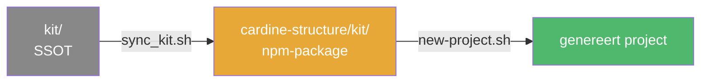

# cardine-structure

> **De projectstandaard voor ieder project, ongeacht editor of abonnement.**

Een AI-agent werkt het best als hij de boom kent. Zonder vaste structuur raadt
hij mappen, mist conventies, en begint elke sessie opnieuw. `cardine-structure`
zet een bewezen projectboom neer — docs, data, besluiten, logs, werkitems —
zodat mens én agent meteen weten waar alles staat.

Dit is het **gratis product**: geen editor, geen abonnement, geen lock-in.
Alleen de structuur, klaar om in te werken met de editor en agent die je al
hebt. Zie [docs/decisions/packages-context.md](../../docs/decisions/packages-context.md)
voor de context (vraag A6 — structuur docs vs code, A8 — formaat
per publiek, A9 — session-scope) en het bijbehorende besluit
[ADR 0009](../../docs/decisions/0009-het-product-is-de-gratis-projectstructuur-en-een-gids-naar-de-agent-paden.md).

---

## Hoe de structuur is ontstaan

De projectstandaard is niet van de ene op de andere dag bedacht. Hij is
gegroeid uit maanden experimenteren met AI-agenten in verschillende editors
(Zed, Cursor, VS Code), verschillende projecttypes (web-apps, data-pipelines,
research) en verschillende stacks (Next.js, NestJS, Python, SQL).

De lessen uit die experimenten — wat werkt voor een agent, wat niet, welke
mappen een agent nodig heeft om context te begrijpen — zijn samengebracht in
[`kit/`](../../kit/README.md) in deze repo (SSOT). `cardine-structure` bevat er een
kopie van.

Zie voor de achtergrond:
- [docs/decisions/packages-context.md](../../docs/decisions/packages-context.md) —
  Context: waarom een projectstructuur, waarom dual (docs + code), waarom de kit de bron is
- [ADR 0013](../../docs/decisions/0013-cardine-is-het-publieke-uithangbord-en-pullt-de-structure-uit-agent-engineering.md) —
  Waarom de structuur in `kit/` blijft
- [ADR 0004](../../docs/decisions/0004-de-projectstandaard-is-dual-een-dunne-agents-md-en-een-harde-make-check.md) —
  Waarom de standaard dual is: een dunne AGENTS.md en een harde make check

---

## Installatie

### Vereisten

- **Node.js** 18+ (voor `npx`) of **Git** (voor direct gebruik)
- Geen editor-vereiste — werkt met Zed, VS Code, Cursor, terminal

### Optie A — via npx

```bash
npx @lennaertds/cardine-structure mijn-project --profile app --modules research,agent
```

Dit is de aanbevolen manier. Het downloadt en draait `new-project.sh` zonder
dat je iets hoeft te installeren.

### Optie B — via GitHub release

```bash
# Download de nieuwste release van
# https://github.com/Lennaertds/cardine/releases
# en draai:
bash kit/new-project.sh mijn-project --profile app
```

### Optie C — direct uit de repo

```bash
git clone https://github.com/Lennaertds/cardine.git
bash cardine/packages/structure/kit/new-project.sh mijn-project
```

### Opties voor `new-project.sh`

| Optie | Beschrijving | Voorbeeld |
|-------|-------------|-----------|
| `--profile` | Voorgedefinieerde combinatie van modules/stacks | `--profile app`, `--profile full` |
| `--modules` | Modules toevoegen (komma-gescheiden) | `--modules research,agent,design` |
| `--stacks` | Stacks toevoegen (komma-gescheiden) | `--stacks next,python` |
| `--team` | Team-map met CI en templates | `--team` |

Zie [docs/cardine-structure.md](docs/cardine-structure.md) voor alle profiles
en modules.

---

## Wat je krijgt

### De boom

```
mijn-project/
├── README.md               ← Project-beschrijving
├── AGENTS.md               ← Agent-instructies
├── Makefile                ← check, context, finish
├── .gitignore / .editorconfig
├── docs/
│   ├── INDEX.md            ← Doc-kaart — startpunt voor elke vraag
│   ├── context/            ← Waarom, voor wie, termen
│   ├── rules/              ← Grenzen, wat nooit mag
│   ├── product/            ← Wat het product doet
│   ├── architecture/       ← Hoe het in elkaar zit
│   ├── decisions/          ← ADR's (waarom het zo is)
│   ├── how-to/             ← Taken uitvoeren
│   ├── research/           ← Wat we weten, experimenten
│   └── work/               ← Backlog, specs, logs, meetings
├── data/
│   ├── raw/                ← Bron-data (niet in git)
│   ├── external/           ← Externe data (niet in git)
│   ├── interim/            ← Tussenstanden (niet in git)
│   ├── processed/          ← Verwerkte data
│   ├── reference/          ← Naslag (wel in git)
│   └── runtime/            ← Runtime-artefacten (niet in git)
├── apps/                   ← Applicatiecode (per app)
└── packages/               ← Deelbare code
```

### Lagen

| Laag | Beschrijving | Verplicht? |
|------|-------------|-----------|
| `kern/` | README, AGENTS.md, Makefile, docs/, data/ (5 lagen) | altijd |
| `solo/` | .cursorrules, work/ (BACKLOG, specs, logs) | standaard |
| `logging/` | logs/status-log.md, logs/onderwerpen/ | altijd |
| `team/` | .github/ (CI, PR-template, issues) | optioneel (`--team`) |
| `modules/<naam>/` | Per domein (agent, research, design, compose, …) | optioneel (`--modules`) |
| `stacks/<stack>/` | Per tech-stack (next, nest, python, sql, rust, c) | optioneel (`--stacks`) |
| `profiles/<naam>.profile` | Voorgedefinieerde combinaties | optioneel (`--profile`) |
| `new-project.sh` | Generator-script | ja |

### Wat een agent ermee kan

Met een vaste boom navigeert een agent moeiteloos:

1. **`docs/INDEX.md`** — één ingang voor alle documentatie. De agent leest dit
   en weet meteen waar docs, regels, besluiten en werkitems staan.
2. **`docs/decisions/`** — ADR's leggen vast waarom iets zo is. De agent
   raadpleegt ze bij twijfel over architectuur.
3. **`docs/rules/`** — harde grenzen die de agent nooit overschrijdt.
4. **`docs/work/`** — backlog, specs, logs. De agent weet wat er nog moet
   gebeuren en wat er al gedaan is.
5. **`Makefile`** — `make check` valideert links, lint en tests.
   `make context` geeft de agent startcontext.

Zie [docs/INDEX.md](../../docs/INDEX.md) voor de volledige navigatie-structuur.

---

## Hoe de distributie werkt

De structuur wordt onderhouden in [`kit/`](../../kit/README.md) (SSOT).



Bij elke release van `cardine-structure`:

1. Soms: `make tag-kit TAG=v0.2.0` na een opvallende kit-wijziging
2. `sync_kit.sh` kopieert de bron `kit/` naar `packages/structure/kit/`
3. Versie ophogen, changelog bijwerken

Zie [packages/structure/sync_kit.sh](sync_kit.sh) voor het script en
[docs/cardine-structure.md](docs/cardine-structure.md) voor de details.

---

## Wat niet in het package gaat

Deze onderdelen van de standaard staan in de repo maar niet in het npm-package —
ze bevatten principes, gidsen en interne tooling:

| Onderdeel | Waarom privé |
|-----------|-------------|
| `standaard/` | Regels, principes, waarom de structuur zo is |
| `sjablonen/` | Invulgidsen per bestand — uitleg voor de maker |
| `nieuw-project/`, `bestaand-project/` | Gidsen voor het gebruik van de kit |
| `bron/` | Kennis, principes, fundament — research en achtergrond |
| `meten/` | Meetprotocollen, taken, resultaten |
| `scripts/` | Interne tooling (test-kit, bootstrap, sessielogs) |

---

## Versiebeheer

Dit package heeft een **eigen versie**, onafhankelijk van `cardine-lab` en de
meta-package. SemVer — `major.minor.patch`.

| Actie | Versie |
|-------|--------|
| Huidige versie | [0.4.0](CHANGELOG.md) |
| Git-tag | `structure-v<semver>` |
| CHANGELOG | [CHANGELOG.md](CHANGELOG.md) |

Een *major* is een breaking change in de kit-structuur (bijv. een laag
hernoemd of verwijderd). Een *minor* is een nieuwe module of stack. Een *patch*
is een bugfix of documentatie.

Zie [docs/packages/VERSIONING.md](../../docs/packages/VERSIONING.md) voor het
volledige schema.

---

## Relaties met andere packages

| Package | Relatie |
|---------|---------|
| **[cardine (meta)](../../README.md)** | Dit package maakt deel uit van de meta-verwijzingen. De root-README geeft het overzicht. |
| **[cardine-lab](../lab/README.md)** | Installeert de toolchain. `cardine-structure` kan los gebruikt worden, maar samen geven ze een volledig werkstation. |

---

## Meer lezen

| Waar | Wat |
|------|-----|
| [docs/cardine-structure.md](docs/cardine-structure.md) | Volledige documentatie van dit package |
| [sync_kit.sh](sync_kit.sh) | Kopieert de bron `kit/` naar de publieke distributiekopie |
| [docs/packages/VERSIONING.md](../../docs/packages/VERSIONING.md) | Versiebeheer-schema |
| [docs/product/PRODUCT.md](../../docs/product/PRODUCT.md) | Productoverzicht van Cardine |
| [README.md](../../README.md) | Meta-package — overzicht van alles |