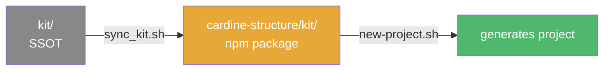

# cardine-structure

> **The project standard for every project, regardless of editor or subscription.**

An AI agent works best when it knows the tree. Without a fixed structure it
guesses at directories, misses conventions, and every session starts over.
`cardine-structure` lays down a proven project tree — docs, data, decisions,
logs, work items — so human and agent both know immediately where everything
lives.

This is the **free product**: no editor, no subscription, no lock-in. Just the
structure, ready to work in with the editor and agent you already have. See
[docs/decisions/packages-context.md](../../docs/decisions/packages-context.md)
for the context (question A6 — structure docs vs code, A8 — format per audience,
A9 — session scope) and the corresponding decision
[ADR 0009](../../docs/decisions/0009-the-product-is-the-free-project-structure-and-a-guide-to-the-agent-paths.md).

---

## How the structure came about

The project standard was not invented overnight. It grew from months of
experimenting with AI agents in different editors (Zed, Cursor, VS Code),
different project types (web apps, data pipelines, research) and different
stacks (Next.js, NestJS, Python, SQL).

The lessons from those experiments — what works for an agent, what does not,
which directories an agent needs to understand context — are gathered in
[`kit/`](../../kit/README.md) in this repo (SSOT). `cardine-structure` contains a
copy of it.

Background:
- [docs/decisions/packages-context.md](../../docs/decisions/packages-context.md) —
  Context: why a project structure, why dual (docs + code), why the kit is the source
- [ADR 0013](../../docs/decisions/0013-cardine-is-the-public-shop-window-and-pulls-the-structure-from-agent-engineering.md) —
  Why the structure stays in `kit/`
- [ADR 0004](../../docs/decisions/0004-the-project-standard-is-dual-a-thin-agents-md-and-a-hard-make-check.md) —
  Why the standard is dual: a thin AGENTS.md and a hard make check

---

## Install

### Requirements

- **Node.js** 18+ (for `npx`) or **Git** (for direct use)
- No editor requirement — works with Zed, VS Code, Cursor, a terminal

### Option A — via npx (recommended)

```bash
npx @lennaertds/cardine-structure my-project --profile app --modules research,agent
```

Pulls the package from the public npm registry and runs `new-project.sh` without
installing anything. Works in an empty directory too.

### Option B — install globally

```bash
npm i -g @lennaertds/cardine-structure
cardine-structure my-project --profile app
```

The `bin` is called `cardine-structure`. Handy if you set the structure up often.

### Option C — straight from the repo

```bash
git clone https://github.com/Lennaertds/cardine.git
bash cardine/packages/structure/kit/new-project.sh my-project
```

This variant needs no npm: only Git and Bash.

### Options for `new-project.sh`

| Option | Description | Example |
|--------|-------------|---------|
| `--profile` | Predefined combination of modules/stacks | `--profile app`, `--profile research` |
| `--modules` | Add modules (comma-separated) | `--modules research,agent,design` |
| `--stacks` | Add stacks (comma-separated) | `--stacks next,python` |
| `--team` | Team layer with CI and templates | `--team` |

See [docs/cardine-structure.md](docs/cardine-structure.md) for every profile and
module.

---

## What you get

### The tree

```
my-project/
├── README.md               ← Project description
├── AGENTS.md               ← Agent instructions
├── Makefile                ← check, context, finish
├── .gitignore / .editorconfig
├── docs/
│   ├── INDEX.md            ← Doc map — starting point for any question
│   ├── context/            ← Why, for whom, terms
│   ├── rules/              ← Boundaries, what never happens
│   ├── product/            ← What the product does
│   ├── architecture/       ← How it fits together
│   ├── decisions/          ← ADRs (why things are the way they are)
│   ├── how-to/             ← Performing tasks
│   ├── research/           ← What we know, experiments
│   └── work/               ← Backlog, specs, logs, meetings
├── data/
│   ├── raw/                ← Source data (not in git)
│   ├── external/           ← External data (not in git)
│   ├── interim/            ← Intermediate states (not in git)
│   ├── processed/          ← Processed data
│   ├── reference/          ← Reference material (in git)
│   └── runtime/            ← Runtime artefacts (not in git)
├── apps/                   ← Application code (per app)
└── packages/               ← Shareable code
```

### Layers

| Layer | Description | Required? |
|-------|-------------|-----------|
| `kern/` | README, AGENTS.md, Makefile, docs/, data/ (5 layers) | always |
| `solo/` | .cursorrules, work/ (BACKLOG, specs, logs) | default |
| `logging/` | logs/status-log.md, logs/topics/ | always |
| `team/` | .github/ (CI, PR template, issues) | optional (`--team`) |
| `modules/<name>/` | Per domain (agent, research, design, compose, …) | optional (`--modules`) |
| `stacks/<stack>/` | Per tech stack (next, nest, python, sql, rust, c) | optional (`--stacks`) |
| `profiles/<name>.profile` | Predefined combinations | optional (`--profile`) |
| `new-project.sh` | Generator script | yes |

### What an agent can do with it

With a fixed tree an agent navigates effortlessly:

1. **`docs/INDEX.md`** — one entrance to all documentation. The agent reads this
   and knows immediately where docs, rules, decisions and work items live.
2. **`docs/decisions/`** — ADRs record why something is the way it is. The agent
   consults them when architecture is in doubt.
3. **`docs/rules/`** — hard boundaries the agent never crosses.
4. **`docs/work/`** — backlog, specs, logs. The agent knows what still needs to
   happen and what is already done.
5. **`Makefile`** — `make check` validates links, lint and tests.
   `make context` gives the agent starting context.

See [docs/INDEX.md](../../docs/INDEX.md) for the full navigation structure.

---

## How distribution works

The structure is maintained in [`kit/`](../../kit/README.md) (SSOT).



On every release of `cardine-structure`:

1. Sometimes: `make tag-kit TAG=v0.2.0` after a notable kit change
2. `sync_kit.sh` copies the source `kit/` into `packages/structure/kit/`
3. Bump the version, update the changelog

See [packages/structure/sync_kit.sh](sync_kit.sh) for the script and
[docs/cardine-structure.md](docs/cardine-structure.md) for the details.

---

## What is not in the package

These parts of the standard live in the repo but not in the npm package — they
contain principles, guides and internal tooling:

| Part | Why private |
|------|-------------|
| `standard/` | Rules, principles, why the structure is the way it is |
| `sjablonen/` | Fill-in guides per file — explanation for the maker |
| `new-project/`, `existing-project/` | Guides for using the kit |
| `bron/` | Knowledge, principles, fundamentals — research and background |
| `measurement/` | Measurement protocols, tasks, results |
| `scripts/` | Internal tooling (test-kit, bootstrap, session logs) |

---

## Versioning

This package has its **own version**, independent of `cardine-lab` and the meta
package. SemVer — `major.minor.patch`.

| Item | Value |
|------|-------|
| Current version | 0.5.1 ([CHANGELOG](CHANGELOG.md)) |
| Git tag | `structure-v<semver>` |
| CHANGELOG | [CHANGELOG.md](CHANGELOG.md) |

A *major* is a breaking change in the kit structure (for example a layer renamed
or removed). A *minor* is a new module or stack. A *patch* is a bugfix or
documentation.

See [docs/packages/VERSIONING.md](../../docs/packages/VERSIONING.md) for the full
scheme.

---

## Relations to other packages

| Package | Relation |
|---------|----------|
| **[cardine (meta)](../../README.md)** | This package is part of the meta's references. The root README gives the overview. |
| **[cardine-lab](../lab/README.md)** | Installs the toolchain. `cardine-structure` works on its own, but together they give a complete workstation. |

---

## Read more

| Where | What |
|-------|------|
| [docs/cardine-structure.md](docs/cardine-structure.md) | Full documentation of this package |
| [sync_kit.sh](sync_kit.sh) | Copies the source `kit/` into the public distribution copy |
| [docs/packages/VERSIONING.md](../../docs/packages/VERSIONING.md) | Versioning scheme |
| [docs/product/PRODUCT.md](../../docs/product/PRODUCT.md) | Cardine product overview |
| [README.md](../../README.md) | Meta package — overview of everything |
